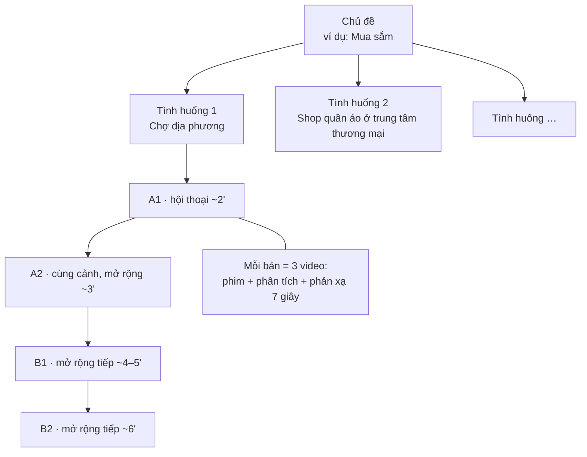

# 4. Chiến lược chủ đề: Chủ đề › Tình huống › 4 trình độ — và 50 tình huống đầu tiên

## Cấu trúc nội dung

- **Chủ đề** (Mua sắm, Ăn uống, Sân bay…) gồm **nhiều tình huống**.
- **Mỗi tình huống có 4 bản A1 → A2 → B1 → B2.** Đây là **cùng một cảnh, cùng bối cảnh, cùng nhân vật chính**. Bản sau **giữ các bước của bản trước** (nói lại bằng câu khó hơn) và **thêm bước mới**, nên hội thoại dài dần.
- **Mỗi bản có 3 video:** video phim, video **Phân tích & giải thích** (ngữ pháp, từ vựng, cách dùng) và video **Phản xạ 7 giây** (luyện nói, 2 chiều) — đều dùng câu của chính bản đó ([11-video-luyen-tap.md](11-video-luyen-tap.md)).
- Khi tình huống đủ 4 bản, ghép thêm **1 video tổng hợp** (A1 → B2).

**1 tình huống = 4 phim + 4 video phân tích + 4 video phản xạ + 1 tổng hợp = 13 video.**

Ví dụ đầy đủ: [Ăn uống › Tình huống 1: Gọi phở ở quán Cô Ba](../video-mau/chu-de-an-uong/th01-goi-pho-quan-co-ba/README.md) — có bảng cho thấy từng bước của cảnh được mở rộng qua 4 bản.

## Quy tắc mở rộng một tình huống qua 4 bản

| Yếu tố | A1 | A2 | B1 | B2 |
| --- | --- | --- | --- | --- |
| **Hội thoại (phim)** | **~2 phút** | ~3 phút | ~4–5 phút | ~6 phút |
| **Cả video phim** | ~4 phút | 5–6 phút | ~8 phút | ~11 phút |
| **Cảnh** | **Lõi**: 1 giao dịch đơn giản, các bước cơ bản (chào → hỏi → chọn → trả tiền) | Lõi + 1–2 bước mới + 1 trục trặc nhỏ | Lõi mở rộng + vấn đề thật phải giải quyết hoặc giải thích; có thể thêm người | Lõi mở rộng + nhiều bên, lợi ích trái ngược: thương lượng, thuyết phục, trình bày |
| **Số người nói** | 2 | 2–3 | 3–4 | 3–5 |
| **Vai của nhân vật chính / người học** | Khách hoặc người phục vụ đơn giản | Chủ động, xử lý trục trặc | **Đổi vai**: chủ nhà, người giải thích | **Người dẫn dắt**: quản lý, người đàm phán |
| **Độ dài câu** | ≤ 8 từ | ≤ 12 từ | ≤ 18 từ | ≤ 25 từ, có chen ngang |
| **Ngữ pháp trọng tâm** | Hiện tại đơn, *can*, *How much*, số đếm, *please* | Quá khứ đơn, *would like*, *could*, *will*, so sánh | Hiện tại hoàn thành, điều kiện loại 1–2, cụm động từ | Điều kiện hỗn hợp, bị động, nói giảm nói tránh, từ nối lập luận |
| **Mẫu câu mới** (tùy cảnh, không cố định) | 4–8 | 6–10 | 8–12 | 10–14 |
| **Ôn từ bản trước** | — | ≥ 50% câu A1, ở dạng dài hơn | ≥ 50% câu A1–A2 | ≥ 50% câu A1–B1, trang trọng hơn |
| **Tiếng Việt trong video** | ~55% | ~35% | ~15% | ~5% |

**Cách nối các bản:**

- Bản sau mở đầu bằng **"Ôn lại" 20–30 giây** — cắt tự động từ bản trước.
- Bản trước kết thúc bằng **teaser bản sau** + end screen trỏ sang video đó.
- **Không đổi bối cảnh giữa các bản.** Muốn đổi bối cảnh (ví dụ từ chợ sang trung tâm thương mại) thì đó là **tình huống khác**.

### Ví dụ: Mua sắm › Tình huống "Chợ địa phương"

| Bước trong cảnh | A1 (~2') | A2 (~3') | B1 (~4–5') | B2 (~6') |
| --- | --- | --- | --- | --- |
| Chào, hỏi hàng | Hello! How much is it? | How much are the mangoes? Are they sweet? | Which ones are in season right now? | What's your best price if we buy every week? |
| Chọn, số lượng | One kilo, please. | Can I choose them myself? Two kilos of these. | I'd like the ripe ones for today and some for tomorrow. | We'd need about twenty kilos, delivered every Monday. |
| Trả giá | — | **mới:** That's a bit expensive. Can you do 50,000? | Bought too many — could you give me a discount? | Let's meet halfway: 40,000 a kilo, provided the quality stays the same. |
| Sự cố | — | — | **mới:** Some of them are rotten. Could I exchange them? | **mới:** Last week's delivery was late. What can you do about that? |
| Trả tiền | Here you are. Thank you! | Can I pay by QR code? | Could I have a receipt? | We'll pay at the end of each month. Can we put that in writing? |

## 50 tình huống đầu tiên

12 chủ đề × 4 tình huống = 48, cộng 2 video đặc biệt. Mỗi tình huống là 13 video, nên danh sách này là **kho nội dung cho 2–3 năm** (ở nhịp 2–3 tình huống/tháng).

**Cách đọc:** Ưu tiên P1 = làm trong 1–2 tháng đầu, P2 = tháng 3–6, P3 = sau đó. Tìm kiếm / Thu hút: H (cao), M (trung bình), L (thấp) — đánh giá định tính theo từ khóa phổ biến ở Việt Nam và độ gần gũi của tình huống. **Cần xác nhận bằng YouTube autocomplete, vidIQ/TubeBuddy, Google Trends (Việt Nam)** ở Tuần 1.

| # | Chủ đề | Tình huống | A1 (lõi ~2') | Mở rộng A2 → B1 → B2 | Ưu tiên | Tìm kiếm | Thu hút |
| --- | --- | --- | --- | --- | --- | --- | --- |
| 1 | Ăn uống | **Gọi phở ở quán Cô Ba** (mẫu) | Jake gọi 1 tô phở, hỏi giá | Món chay, bưng nhầm, tiền thối → đãi bố mẹ Jake, giải thích món, giành trả tiền → đàm phán hợp đồng nấu tiệc | P1 | H | H |
| 2 | Ăn uống | Quán cà phê | Gọi cà phê sữa đá mang đi | Tùy chỉnh đường/đá, làm sai order → giới thiệu cà phê muối, xử lý phàn nàn → thuyết trình mở quầy cà phê với nhà đầu tư | P1 | M | H |
| 3 | Ăn uống | Nhà hàng ở nước ngoài | Đặt bàn, gọi 1 món, tính tiền | Dị ứng, không trả được bằng QR ([bản nháp A2](../video-mau/chu-de-an-uong/th03-nha-hang-nuoc-ngoai/A2-ban-nhap/script.md)) → món ra sai, hỏi tip → đặt tiệc sinh nhật bất ngờ, thương lượng set menu | P2 | H | H |
| 4 | Ăn uống | Gọi điện đặt bàn, đặt món giao | Đặt bàn: giờ, số người | Đổi giờ, chọn chỗ ngồi → đơn giao trễ/thiếu, khiếu nại → thương lượng hợp tác với nền tảng giao đồ ăn | P2 | M | M |
| 5 | Mua sắm | **Chợ địa phương** | Hỏi giá, mua 1 ký xoài | Chọn hàng, trả giá → trái hư, đổi hàng → đặt hàng sỉ định kỳ cho quán | P1 | H | M |
| 6 | Mua sắm | Siêu thị | Hỏi chỗ để hàng, thanh toán | Khuyến mãi, thẻ thành viên → bị tính tiền 2 lần, hoàn tiền → góp ý dịch vụ với quản lý | P2 | M | M |
| 7 | Mua sắm | Shop quần áo ở trung tâm thương mại | Hỏi giá, hỏi size | Mặc thử, đổi màu, trả giá → đổi hàng lỗi, chính sách đổi trả → đặt đồng phục in logo cho quán | P1 | H | H |
| 8 | Mua sắm | Mua online & đổi trả | Hỏi hàng còn không qua chat | Đặt hàng, phí ship → giao sai size, gọi đổi trả → khiếu nại leo thang, đòi bồi thường | P2 | M | H |
| 9 | Chào hỏi | Hàng xóm mới | Jake dọn đến: chào, tên, quê | Hỏi nghề, mời trà → giới thiệu khu phố, quy tắc xóm → họp tổ dân phố giải quyết tranh cãi tiếng ồn | P2 | H | M |
| 10 | Chào hỏi | Câu lạc bộ tiếng Anh | Tự giới thiệu | Hỏi đáp công việc, cuối tuần → kể chuyện, giữ hội thoại → tranh luận một chủ đề | P2 | M | M |
| 11 | Chào hỏi | Tiệc sinh nhật | Chúc mừng, tặng quà | Làm quen người lạ → kể chuyện, phát biểu ngắn → làm MC, ứng biến khi có sự cố | P3 | M | H |
| 12 | Chào hỏi | Sự kiện networking | Chào, trao danh thiếp | Small talk công việc → giới thiệu dự án, xin liên lạc → thuyết phục đối tác | P3 | M | M |
| 13 | Đi lại | Hỏi đường | Du khách hỏi đường ra chợ | Chỉ đường nhiều bước → dẫn tour đi bộ → hướng dẫn viên xử lý khách lạc đoàn, đổi lịch trình | P2 | H | M |
| 14 | Đi lại | Xe ôm công nghệ, taxi | Nói điểm đến | Điểm đón khó tìm, kẹt xe → quên đồ trên xe → khiếu nại tính sai tiền | P2 | M | H |
| 15 | Đi lại | Mua vé tàu, xe khách | Mua 1 vé | Chọn giờ, ghế, khứ hồi → đổi/hủy vé → đặt vé đoàn, thương lượng | P3 | M | M |
| 16 | Đi lại | Thuê xe máy | Hỏi giá thuê | Giấy tờ, xăng, mũ bảo hiểm → xe hỏng giữa đường → tranh chấp tiền cọc vì vết trầy | P3 | L | H |
| 17 | Sân bay | Check-in | Hộ chiếu, chỗ ngồi | Hành lý quá cân → đổi chuyến, nâng hạng → bán quá số ghế, thương lượng bồi thường | P1 | H | H |
| 18 | Sân bay | An ninh & lên máy bay | Qua cửa an ninh | Bị giữ chai nước, tìm cổng → đổi cổng, trễ chuyến → lỡ chuyến, đổi vé, quyền lợi | P2 | H | H |
| 19 | Sân bay | Trên máy bay | Xin nước, đồ ăn | Đổi chỗ, xin chăn → hành khách bên cạnh gây khó chịu → hỗ trợ khi có người bị mệt | P3 | M | M |
| 20 | Sân bay | Nhập cảnh & hành lý | Trả lời mục đích chuyến đi | Lấy hành lý, khai báo → mất hành lý, làm đơn → bị phỏng vấn kỹ ở cửa nhập cảnh | P2 | H | H |
| 21 | Lưu trú | Check-in homestay Đà Lạt | Tên, số đêm, wifi | Giờ ăn sáng, gửi đồ → đặt phòng bị trùng → thương lượng hợp đồng với công ty lữ hành | P2 | H | M |
| 22 | Lưu trú | Sự cố trong phòng | Xin thêm khăn | Máy nước nóng hỏng → đổi phòng, phàn nàn tiếng ồn → phản hồi đánh giá 1 sao (vai chủ homestay) | P2 | M | M |
| 23 | Lưu trú | Đặt phòng qua điện thoại | Đặt 1 phòng | Hỏi giá, chính sách → sửa ngày, yêu cầu đặc biệt → đàm phán giá cho đoàn | P3 | M | L |
| 24 | Lưu trú | Trả phòng | Trả phòng, cảm ơn | Hóa đơn, phí phát sinh → hóa đơn sai → thương lượng hoàn tiền vì dịch vụ kém | P3 | M | L |
| 25 | Sức khỏe | Nhà thuốc | Đau đầu, mua thuốc | Liều dùng, tác dụng phụ → triệu chứng phức tạp, dị ứng thuốc → Tín tư vấn giúp Jake | P2 | M | M |
| 26 | Sức khỏe | Phòng khám | Đăng ký khám | Jake đau bụng sau khi ăn ốc → hiểu chỉ định, xét nghiệm → bàn phương án điều trị, chi phí, bảo hiểm | P2 | M | H |
| 27 | Sức khỏe | Nha sĩ | Đau răng, đặt lịch | Khám, mô tả đau → hỏi phương án và giá → khiếu nại dịch vụ | P3 | L | M |
| 28 | Sức khỏe | Va quẹt xe & cấp cứu | Gọi giúp đỡ | Trao đổi thông tin → kể lại sự việc cho bảo hiểm → thương lượng bồi thường | P3 | M | M |
| 29 | Gia đình & lễ Tết | Giới thiệu gia đình | Giới thiệu thành viên | Nghề nghiệp, tính cách → kể chuyện, truyền thống gia đình → thảo luận khác biệt gia đình Việt – Mỹ | P2 | H | M |
| 30 | Gia đình & lễ Tết | Ăn Tết nhà Cô Ba | Chúc Tết, lì xì | Món Tết, phong tục → giải thích ý nghĩa phong tục → podcast tranh luận Tết xưa – Tết nay | P2 (trước Tết) | H | H |
| 31 | Gia đình & lễ Tết | Đám cưới Việt | Chúc mừng cô dâu chú rể | Hỏi về nghi lễ → giải thích cho Jake → phát biểu chúc mừng bằng tiếng Anh | P3 | M | H |
| 32 | Gia đình & lễ Tết | Trung thu | Mời bánh trung thu | Rước đèn → kể truyền thuyết → tổ chức Trung thu cho trẻ em, kêu gọi tài trợ | P3 | M | M |
| 33 | Dịch vụ | Gọi điện đặt lịch (cắt tóc, sửa xe) | Đặt lịch | Đổi lịch → dịch vụ không như ý → thương lượng bồi hoàn | P3 | M | L |
| 34 | Dịch vụ | Shipper giao hàng (Tony) | Xác nhận địa chỉ | Hẻm khó tìm → giao trễ, khách phàn nàn → Tín xử lý đơn lỗi với khách doanh nghiệp | P2 | L | H |
| 35 | Dịch vụ | Tổng đài chăm sóc khách hàng | Hỏi thông tin | Báo lỗi wifi → yêu cầu hoàn tiền → leo thang khiếu nại | P3 | M | M |
| 36 | Dịch vụ | Ngân hàng | Đổi tiền | Jake mở tài khoản → thẻ bị nuốt ở ATM → Tín vay vốn mở rộng quán | P3 | M | M |
| 37 | Công sở | Ngày đầu đi làm (Linh) | Giới thiệu bản thân | Hỏi quy trình, nhờ giúp → nhận góp ý, xin lỗi lỗi nhỏ → đề xuất cải tiến với sếp | P2 | H | M |
| 38 | Công sở | Họp nhóm | Báo việc đã làm | Báo tiến độ, vướng mắc → báo trễ deadline, đề xuất → thuyết trình và bảo vệ ý kiến | P2 | H | M |
| 39 | Công sở | Làm việc với khách hàng nước ngoài | Chào qua video call | Xác nhận yêu cầu → giải thích lỗi, cam kết → đàm phán phạm vi và chi phí | P3 | H | M |
| 40 | Công sở | Xin nghỉ phép, báo ốm | Báo ốm | Xin nghỉ phép → bàn giao công việc → thương lượng làm việc từ xa | P3 | M | L |
| 41 | Phỏng vấn | Phỏng vấn làm thêm (quán cà phê) | Giới thiệu bản thân | Kinh nghiệm, giờ làm → câu hỏi tình huống với khách → thương lượng lương, ca làm | P2 | H | H |
| 42 | Phỏng vấn | Phỏng vấn thực tập | Học vấn, sở thích | Điểm mạnh, điểm yếu → kể một dự án ở trường → hỏi lại nhà tuyển dụng, lộ trình | P2 | H | M |
| 43 | Phỏng vấn | Phỏng vấn công ty nước ngoài | *Tell me about yourself* | Kinh nghiệm làm việc → câu hỏi hành vi (STAR) → đàm phán offer | P2 | H | H |
| 44 | Phỏng vấn | Phỏng vấn online | Chào, kiểm tra âm thanh | Sự cố mạng, xin lặp lại → trình bày qua chia sẻ màn hình → thuyết phục ở vòng cuối | P3 | M | M |
| 45 | Du lịch | Tham quan, mua vé | Mua vé, nhờ chụp hình | Giờ mở cửa, tour → hướng dẫn viên giới thiệu → kể lại chuyến đi thành câu chuyện (vlog) | P2 | M | M |
| 46 | Du lịch | Một ngày ở Hội An | Thuê xe đạp | May áo dài, trả giá → giới thiệu phố cổ cho khách → thương lượng tour riêng | P3 | M | H |
| 47 | Du lịch | Karaoke với đồng nghiệp | Rủ đi, nhận lời | Chọn bài, gọi đồ → từ chối khéo, trò chuyện → giải quyết hiểu lầm | P3 | L | H |
| 48 | Du lịch | Xem phim, đặt vé | Mua vé | Chọn ghế, combo → đổi suất chiếu → review phim, tranh luận | P3 | M | M |
| 49 | Đặc biệt | 20 lỗi "Vietglish" của Tony | Tổng hợp các lỗi Tony đã mắc, kèm cách sửa | — | P2 | M | H |
| 50 | Đặc biệt | Toàn bộ A1 chủ đề Ăn uống | Ghép 4 bản A1 của tình huống 1–4 + bài kiểm tra | — | P3 | H | M |

## Lịch sản xuất và đăng

**Một tuần = một bản của một tình huống (3 video):** phim (thứ 2) → phân tích & giải thích (thứ 4) → phản xạ 7 giây (thứ 6). Một tình huống hoàn thành trong 4 tuần, tuần 5 đăng video tổng hợp.

**Chạy 2 tình huống song song** (lệch nhau 2 tuần) để luôn có video A1 mới cho người mới bắt đầu:

| Tuần | Tình huống 1 (Gọi phở) | Tình huống 5 (Chợ) | Số video |
| --- | --- | --- | --- |
| 1 | A1 ×3 | — | 3 |
| 2 | A2 ×3 | — | 3 |
| 3 | B1 ×3 | A1 ×3 | 6 |
| 4 | B2 ×3 | A2 ×3 | 6 |
| 5 | Tổng hợp | B1 ×3 + A1 của tình huống 2 (Cà phê) ×3 | 7 |

Nhịp ổn định: **~6 video dài/tuần** (2 phim + 2 phân tích + 2 phản xạ) + Shorts. Nếu thấy quá tải hoặc chỉ số video đi kèm thấp, giảm còn 1 tình huống/lần.

**Theo mùa:** tình huống Tết (#30) phải bắt đầu đăng **6–8 tuần trước Tết** để kịp cả 4 bản.

### Playlist

Mỗi video nằm trong nhiều playlist:

1. **Theo tình huống:** "Gọi phở ở quán Cô Ba: A1 → B2" (video tổng hợp ghim đầu).
2. **Theo chủ đề và trình độ:** "Ăn uống – A1", "Ăn uống – A2"…
3. **Theo lộ trình toàn kênh:** "Lộ trình A1", "Lộ trình A2", "Lộ trình B1", "Lộ trình B2".
4. **Theo loại video:** "Phân tích & giải thích", "Luyện phản xạ 7 giây".

Lộ trình này về sau có thể đóng gói thành khóa học hoặc sách bài tập.

## Cách đánh giá tiềm năng một tình huống (chấm điểm 1–5)

| Tiêu chí | Trọng số | Cách đo |
| --- | --- | --- |
| Lượng tìm kiếm tại Việt Nam | 30% | YouTube autocomplete tiếng Việt ("tiếng anh giao tiếp khi…"), vidIQ/TubeBuddy, Google Trends (Việt Nam, YouTube Search) |
| Hiệu suất đối thủ | 20% | View trung vị của video cùng chủ đề trên các kênh tiếng Việt trong 12 tháng (YouTube Data API `search.list` với `regionCode=VN`, `relevanceLanguage=vi`) |
| Tính hữu ích thực tế với người Việt | 25% | Người học có gặp tình huống này trong 6 tháng tới không? |
| Có đủ "đất" để mở rộng tới B2 không | 15% | Cảnh có thể phát triển tự nhiên thành thương lượng, xử lý sự cố, trình bày? |
| Chi phí asset | 10% | Bối cảnh đã có trong thư viện? (có = 5 điểm) |

Tình huống ≥ 3,5 điểm → đưa vào lịch sản xuất.
