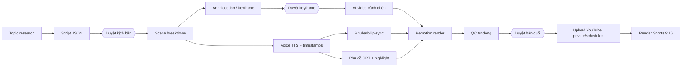

# 8. Kiến trúc tự động hóa

## Lựa chọn công nghệ

**TypeScript (Node.js) + Remotion + SQLite**, chạy trên máy cá nhân; n8n là tùy chọn cho phần thông báo/duyệt.

Lý do: Remotion (engine dựng video) là React/TypeScript → toàn bộ pipeline cùng một ngôn ngữ, chung kiểu dữ liệu `Episode`. Python chỉ cần nếu sau này train LoRA hoặc xử lý ảnh nặng.

## Luồng tổng thể



Hình lục giác = cổng người duyệt. Pipeline **dừng** ở mỗi cổng và gửi thông báo (Telegram/Discord/email) kèm link xem trước.

## Mức độ tự động hóa từng bước

| Bước | Mức | Ghi chú |
| --- | --- | --- |
| Thu thập từ khóa, view đối thủ | **Tự động hoàn toàn** | YouTube Data API; chạy hàng tuần |
| Chấm điểm chủ đề | Tự động + bạn chọn | Script tính điểm, bạn chọn 3–5 chủ đề/tuần |
| Viết kịch bản (draft + editor check CEFR) | Tự động | 2 model: writer → editor |
| **Duyệt kịch bản** | **Người duyệt (bắt buộc)** | Lỗi ngôn ngữ = mất uy tín kênh |
| Scene breakdown, danh sách asset cần tạo | Tự động | Từ JSON kịch bản; đối chiếu thư viện asset |
| Tạo ảnh location mới | Tự động sinh 4 biến thể | **Bạn chọn 1** (vài giây/ảnh) |
| TTS + chuẩn hóa âm lượng | Tự động hoàn toàn | QC tự động: so sánh văn bản ASR với kịch bản |
| Lip-sync (Rhubarb) | Tự động hoàn toàn | |
| Phụ đề + highlight | Tự động hoàn toàn | Từ timestamps TTS |
| **Keyframe cho AI video** | **Người duyệt** | Duyệt ảnh rẻ hơn nhiều so với re-roll video |
| AI video cảnh chèn | Tự động sinh 2 biến thể | Bạn chọn 1 |
| Render (Remotion) | Tự động hoàn toàn | |
| QC tự động | Tự động | Xem danh sách kiểm tra bên dưới |
| **Duyệt bản cuối** | **Người duyệt (bắt buộc)** | Xem ở tốc độ 1,5× |
| Thumbnail | Tự động sinh 3 biến thể | Bạn chọn / A/B test bằng Test & Compare |
| Upload, metadata, phụ đề CC, playlist | Tự động | Upload ở chế độ **private/scheduled**, không public tự động |
| Shorts | Tự động render | Bạn chọn đăng cái nào |
| Báo cáo CTR/retention | Tự động hàng tuần | YouTube Analytics API |

### Chưa nên tự động hóa (chất lượng AI chưa ổn định)

- **Mouth chart và rig nhân vật** — làm tay một lần.
- **Hội thoại nhiều người trong AI video** — lip-sync lẫn người nói, nhân vật trôi chi tiết.
- **Chữ trong ảnh AI** (thumbnail, biển hiệu) — tạo chữ bằng code/template.
- **Public video tự động** — luôn có người bấm nút cuối.
- **Trả lời bình luận tự động** — rủi ro uy tín; chỉ dùng AI gợi ý câu trả lời.

## Cấu trúc dự án đề xuất

```text
pocket-town/
  packages/
    core/         # kiểu Episode, Scene, Line; schema zod; cost ledger
    pipeline/     # các bước: research, script, tts, images, video, lipsync, subtitles, upload
    providers/    # adapter: gemini.ts, elevenlabs.ts, kling.ts, fal.ts, youtube.ts
    render/       # Remotion: DialogueScene, PhraseCard, YourTurn, Quiz, Intro, Outro, Short
    review-ui/    # web nhỏ (Vite/Next) xem trước & bấm duyệt — hoặc dùng n8n Wait node
  assets/         # thư viện nhân vật, location, nhạc (xem 05-quy-trinh-san-xuat.md)
  topics/
    an-uong/
      th01-goi-pho-quan-co-ba/
        situation.json   # bối cảnh, các bước của cảnh, ma trận mẫu câu cho 4 bản
        A1/              # (A2/, B1/, B2/ giống hệt)
          episode.json   # nguồn sự thật duy nhất của bản này
          state.json     # trạng thái từng bước
          practice/      # analysis.json, reflex.json (2 video đi kèm)
          audio/ images/ video/ lipsync/ subs/ out/
  data/pipeline.db     # SQLite: jobs, cache, cost ledger
```

## Các nguyên tắc thiết kế pipeline

### 1. `episode.json` là nguồn sự thật duy nhất, `situation.json` nối 4 bản

Mọi bước đọc/ghi vào `episode.json` (hoặc file cạnh nó). Sửa một câu thoại → chỉ các bước phụ thuộc câu đó chạy lại. Ví dụ đầy đủ: [episode.json bản A1](../video-mau/chu-de-an-uong/th01-goi-pho-quan-co-ba/A1/episode.json).

Cấu trúc dữ liệu theo **chủ đề › tình huống › bản**: `topics/<chủ-đề>/<tình-huống>/situation.json` + 4 thư mục `A1/ A2/ B1/ B2/`, mỗi thư mục có `episode.json` của bản đó. `situation.json` lưu: bối cảnh và nhân vật chung, **các bước của cảnh và bản nào thêm bước nào**, ma trận mẫu câu (mới/ôn/nâng cấp), mạch hài. Pipeline dùng nó để:

- nạp kịch bản bản trước vào prompt khi viết bản sau (giữ đúng các bước cũ, chỉ mở rộng);
- kiểm tra tự động: cùng bối cảnh, ≥ 50% mẫu câu bản trước được ôn lại, hội thoại dài hơn bản trước;
- tự cắt clip "Ôn lại" (20–30 giây) từ audio/hình của bản trước — không tốn chi phí sinh mới;
- gắn end screen và link mô tả giữa 3 video của một bản và giữa các bản;
- **sinh 2 video đi kèm cho mỗi bản** (Phân tích & giải thích, Phản xạ 7 giây) từ các câu `highlight` + ma trận mẫu câu — chi tiết ở [11-video-luyen-tap.md](11-video-luyen-tap.md#tự-động-hóa);
- **dựng video tổng hợp tình huống** khi đủ 4 bản: cắt 4 video phim (bỏ cold open, phần ôn lại, outro trùng), chèn đoạn nối "Lên A2!"… sinh từ ma trận mẫu câu, sinh bài kiểm tra cuối (2 câu/bản), render và đưa vào hàng chờ duyệt.

Mỗi dòng thoại có trường `lang` (`en`/`vi`) → bước TTS chọn đúng giọng, bước Rhubarb chọn recognizer (`pocketSphinx` cho tiếng Anh, `phonetic` cho tiếng Việt), bước phụ đề chọn kiểu 1 dòng hay song ngữ.

### 2. Mỗi bước là hàm thuần + cache theo hash

```ts
// packages/core/cache.ts
const key = sha256(JSON.stringify({ provider, model, input, settings }));
const hit = await cache.get(key);           // SQLite: key -> file path
if (hit) return hit;                        // không trả tiền 2 lần
const out = await withBudget(episodeId, estimateCost(input), () => provider.run(input));
await cache.put(key, out);
```

Lợi ích: chạy lại pipeline sau lỗi không tốn tiền cho phần đã xong; đổi giọng 1 nhân vật chỉ sinh lại câu của nhân vật đó.

### 3. Adapter cho từng nhà cung cấp

```ts
interface VideoProvider {
  name: string;                                  // "kling-3.0" | "gemini-omni-flash" | "fal:kling"
  estimateCost(req: VideoRequest): number;       // USD, dùng cho budget guard
  submit(req: VideoRequest): Promise<JobId>;     // API video là bất đồng bộ
  poll(id: JobId): Promise<JobStatus>;
  download(id: JobId, dest: string): Promise<string>;
}
```

Model AI thay đổi liên tục (Veo 3.1 đã rời bảng giá Gemini API năm 2026). Adapter giúp đổi nhà cung cấp bằng 1 dòng config, không sửa pipeline.

### 4. Xử lý lỗi và retry

| Loại lỗi | Xử lý |
| --- | --- |
| 429 / 5xx / timeout | Retry exponential backoff (2s, 4s, 8s, 16s, tối đa 5 lần) + jitter |
| Job video bị kẹt | Poll mỗi 10–15 s, timeout 10 phút → hủy, thử lại 1 lần, rồi chuyển provider dự phòng |
| Bị chặn bởi bộ lọc an toàn | Không retry nguyên văn; ghi log, báo người duyệt sửa prompt |
| Kết quả kém (QC fail) | Đánh dấu `needs_review`, không tự động re-roll quá 2 lần |
| Lỗi giữa chừng | `state.json` lưu bước đã xong → chạy `pipeline resume an-uong/th01/A1` |

### 5. Kiểm soát chi phí

- **Cost ledger** (bảng SQLite): mỗi lần gọi API ghi `episode, step, provider, model, units, usd_estimate, timestamp`.
- **Ngân sách cứng**: mỗi tập (ví dụ $20), mỗi ngày ($30), mỗi tháng ($400). Vượt → pipeline dừng, gửi thông báo.
- **Ước tính trước khi chạy**: `pipeline plan an-uong/th01/A1` in ra danh sách việc + chi phí dự kiến trước khi thực thi.
- **Đối soát hàng tuần** ledger với hóa đơn thật của từng nhà cung cấp; chỉnh hệ số ước tính.

### 6. QC tự động trước khi người duyệt xem

- ASR (ElevenLabs Scribe hoặc Gemini Transcribe) trên file thoại → so khớp với kịch bản; sai khác > 5% từ → cảnh báo phát âm.
- Âm lượng tích hợp −16 LUFS ±1; không clipping.
- Phụ đề: không dòng nào > 42 ký tự, không hiển thị < 1 giây.
- Không còn khung đen/khung trống; độ dài video khớp tổng scene.
- So màu trung bình vùng trang phục nhân vật trong cảnh chèn AI với bảng màu chuẩn → cảnh báo nhân vật "trôi".

## n8n hay code?

| | Code (TypeScript) | n8n |
| --- | --- | --- |
| Logic phức tạp, cache, kiểu dữ liệu | Tốt | Kém |
| Cổng duyệt, thông báo, lịch chạy | Cần tự viết UI nhỏ | **Có sẵn** (Wait node, Telegram, Schedule) |
| Bảo trì lâu dài | Tốt (git, test) | Trung bình |

→ **Lõi pipeline bằng code**; n8n (self-host miễn phí) chỉ làm lớp điều phối: lịch chạy research hàng tuần, gửi link duyệt, nhận "approve" rồi gọi `pipeline resume`.

## Lộ trình xây dựng tự động hóa

| Giai đoạn | Tự động hóa | Khi nào |
| --- | --- | --- |
| 0 | Thủ công trong web UI các công cụ + CapCut | Video 1–2 (học cảm giác chất lượng) |
| 1 | Script → TTS → phụ đề → Rhubarb (CLI) | Video 3–5 |
| 2 | Remotion render toàn bộ từ `episode.json` | Video 6–10 |
| 3 | Ảnh + AI video qua API, cache, budget | Tháng 2 |
| 4 | Upload, Shorts, báo cáo Analytics, review UI | Tháng 2–3 |
