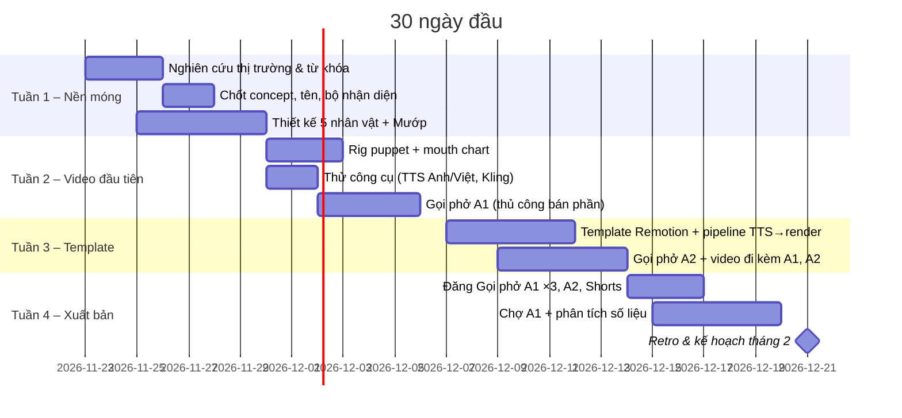

# 10. Lộ trình triển khai 30 ngày

**Mục tiêu cuối tháng:** tình huống **"Gọi phở ở quán Cô Ba" bản A1** đăng đủ 3 video (phim + phân tích & giải thích + phản xạ 7 giây), **bản A2** đăng phim + phân tích; **"Chợ địa phương" bản A1** sản xuất xong (đăng đầu tháng 2) — cùng 12 Shorts (đăng cả TikTok/Reels), 5 nhân vật + mascot và 2 location hoàn chỉnh, pipeline tự động đến bước render, chi phí thử nghiệm ≤ $300.

Giả định thời gian: ~25–30 giờ/tuần.

## Tổng quan

Ngày bắt đầu giả định là Thứ Hai 23/11/2026 — đổi theo lịch của bạn.

## Tuần 1 — Nghiên cứu, concept, nhân vật

| Ngày | Việc | Đầu ra |
| --- | --- | --- |
| 1 | Nghe 2 video tham khảo theo checklist trong [01-phan-tich-kenh-tham-khao.md](01-phan-tich-kenh-tham-khao.md); khảo sát thêm 5–10 kênh/tài khoản Việt (YouTube, TikTok, Facebook) dạy tiếng Anh giao tiếp | Bảng đối thủ Việt Nam |
| 2 | Cài vidIQ/TubeBuddy; chấm điểm 48 tình huống bằng từ khóa tiếng Việt | `situations.csv` có điểm |
| 3 | Kiểm tra tên kênh (YouTube, TikTok, Facebook, domain); chốt tên, logo, bảng màu | Tên kênh + `brand/` |
| 4–5 | Khám phá nhân vật (Midjourney + Nano Banana), chọn hero image cho Tín, Tony, Jake, Cô Ba, Sam, Mướp | 6 hero image |
| 6–7 | Turnaround + expression sheet; viết `character-bible.md` và `story-bible.md` (mạch truyện Hẻm 99) | Character sheet + bible |
| 6–7 | Dự phòng ([docs/12](12-du-phong-rui-ro.md)): tạo giọng nhân vật bằng **Voice Design** + lưu file mẫu 30 giây; chọn font tiếng Việt (OFL); lập bảng từ vựng phản hồi animation | `voice.json`, font, bảng phản hồi |

**Cổng chất lượng tuần 1:** 5 người Việt (đúng khán giả mục tiêu) nhìn character sheet: nhận ra bối cảnh Việt, mô tả được tính cách nhân vật, **không thấy bị rập khuôn hay phản cảm**.

## Tuần 2 — Thử công cụ, video đầu tiên

| Ngày | Việc | Đầu ra |
| --- | --- | --- |
| 8 | Mouth chart 9 khẩu hình × 3 nhân vật nói (chỉnh tay) | `parts/mouth/*.png` |
| 9 | Tách layer puppet; dựng thử 1 cảnh 10 giây bằng Remotion + Rhubarb (hoặc Character Animator) | Clip test lip-sync |
| 9 | Giọng tiếng Anh: ElevenLabs v3 cho Tín, Jake, Tony, Sam. Giọng tiếng Việt: **bài nghe mù** ElevenLabs v3 / Gemini TTS / FPT.AI với 3–5 người Việt; chốt `voice_id` | `voice.json` |
| 9 | Thử Rhubarb chế độ `phonetic` cho câu tiếng Việt | Clip test lip-sync tiếng Việt |
| 10 | So sánh AI video: cùng 1 keyframe chạy Kling 3.0, Kling 2.5 Turbo, Gemini Omni Flash | Bảng chấm điểm nhất quán/giá |
| 10 | **Đo tốc độ render** 1 phút video trên máy → ước tính giờ render/tuần; test font với câu đủ dấu tiếng Việt | Số liệu render, font đã khóa |
| 10 | Tạo ảnh nền Quán Cô Ba + Hẻm 99 | `locations/quan-co-ba/v1/`, `locations/hem-99/v1/` |
| 11–14 | Sản xuất phim **Gọi phở A1** theo [bộ sản xuất mẫu](../video-mau/chu-de-an-uong/th01-goi-pho-quan-co-ba/A1/README.md) (có thể dựng bằng CapCut nếu template chưa xong) | Phim Gọi phở A1 bản final |

**Cổng chất lượng tuần 2:** phim Gọi phở A1 đạt bảng tiêu chí chất lượng bên dưới ≥ 80%; 3 người mất gốc xem xong nói lại được ít nhất 4/6 câu.

## Tuần 3 — Template và sản xuất loạt nhỏ

| Ngày | Việc | Đầu ra |
| --- | --- | --- |
| 15–17 | Remotion components: DialogueScene, PhraseCard (+ thẻ sửa lỗi), SentenceBreakdown + SummaryBoard (video Phân tích), ReflexDrill (video Phản xạ 7 giây), Quiz, Recap (ôn level trước), TitleCard, Outro, Short (9:16) | `packages/render` |
| 15–17 | Pipeline CLI: `script → tts (en/vi) → rhubarb → subtitles song ngữ → render` từ `episode.json` + `situation.json`, có cache + cost ledger | `pipeline` chạy end-to-end |
| 15–17 | Git + sao lưu cloud hằng ngày; nạp sẵn API dự phòng (Gemini, Kling/fal); thêm bước tra IPA tự động cho video Phân tích | Sao lưu chạy tự động |
| 18–19 | Phim **Gọi phở A2** (cùng Quán Cô Ba — không cần ảnh nền mới) bằng pipeline; tự cắt đoạn "Ôn lại A1" | Phim Gọi phở A2 |
| 20–21 | **Phân tích & giải thích** + **Phản xạ 7 giây** cho Gọi phở A1 và A2 (template `SentenceBreakdown`, `ReflexDrill`) | 4 video đi kèm |

**Cổng chất lượng tuần 3:** phim Gọi phở A2 tốn ≤ 5 giờ công và ≤ $8 chi phí API (nhờ tái dùng bối cảnh); mỗi video đi kèm ≤ 1,5 giờ duyệt.

## Tuần 4 — Xuất bản, đo lường, cải thiện

| Ngày | Việc | Đầu ra |
| --- | --- | --- |
| 22 | Tạo kênh, banner (Hẻm 99), avatar (Mướp trên biển số nhà), trailer 30 giây, playlist theo tình huống, chủ đề–trình độ, lộ trình và loại video | Kênh hoàn chỉnh |
| 22–26 | Đăng **Gọi phở A1**: phim (ngày 22) → phân tích (24) → phản xạ (26); mỗi video 3 thumbnail Test & Compare. Giờ đăng gợi ý: 19:00–21:00 giờ Việt Nam (kiểm chứng lại bằng Analytics) | 3 video public |
| 27–30 | Đăng **Gọi phở A2**: phim (27) → phân tích (29); video phản xạ A2 đăng đầu tháng 2 | 2 video public |
| 22–28 | Đăng 12 Shorts (2 Shorts/ngày) trên YouTube + TikTok + Facebook Reels | 12 Shorts × 3 nền tảng |
| 25–28 | Sản xuất **Chợ địa phương A1** (phim + phân tích + phản xạ; ảnh nền chợ mới) — đăng đầu tháng 2 | Chợ A1 ×3 |
| 28–29 | Đọc Analytics: CTR, retention graph (điểm rơi), tỉ lệ chuyển A1 → A2 và phim → video đi kèm, nguồn traffic, comment người Việt | Báo cáo 1 trang |
| 30 | Retro: giữ/bỏ/đổi gì; lịch tháng 2: Gọi phở B1, B2 + video tổng hợp; Chợ A1 → A2 → B1; bắt đầu Quán cà phê A1 (~6 video dài/tuần theo [lịch song song](04-chu-de-va-50-y-tuong.md#lịch-sản-xuất-và-đăng)) | Kế hoạch tháng 2 |

## Tiêu chí đánh giá chất lượng mỗi video

| # | Tiêu chí | Đạt khi |
| --- | --- | --- |
| 1 | Ngôn ngữ | Editor-LLM "pass" + bạn đọc to không vấp; 0 lỗi ngữ pháp |
| 2 | Đúng cấp độ | ≥ 90% câu thoại đúng CEFR mục tiêu |
| 3 | Nhất quán nhân vật | Không có shot nào nhân vật sai trang phục/màu/chi tiết nhận diện |
| 4 | Lip-sync | Không lệch > 2 frame ở các âm môi (M/B/P) |
| 5 | Giọng | Không phát âm sai; cảm xúc khớp `emotion` |
| 6 | Âm thanh | −16 LUFS ±1; nhạc không lấn thoại |
| 7 | Phụ đề | Khớp lời 100%; ≤ 42 ký tự/dòng; highlight đúng cụm |
| 8 | Hook | Có khoảnh khắc hài/căng trong 8 giây đầu |
| 9 | Câu chuyện | Có 1 xung đột nhỏ + 1 cú hài rõ ràng |
| 10 | Giá trị học | Video phim: đủ học mẫu câu + sửa lỗi Vietglish + đố vui; có đủ 2 video đi kèm (phân tích, phản xạ); phần giải thích ngữ pháp đã được kiểm tra |
| 11 | Văn hóa Việt | Bối cảnh, câu đùa, cách xưng hô tự nhiên với người Việt; không rập khuôn, không chế giễu vùng miền |
| 12 | Tiếng Việt | Giải thích ngắn, dễ hiểu với người mất gốc; giọng đọc tiếng Việt tự nhiên, không "giọng máy" |
| 13 | Nối các bản | (Từ A2) cùng bối cảnh với bản trước; ≥ 50% mẫu câu bản trước được ôn lại; có đoạn "Ôn lại" và teaser bản sau |

## Mục tiêu sản lượng và chỉ số (30 ngày)

| Chỉ số | Mục tiêu tối thiểu | Mục tiêu tốt |
| --- | --- | --- |
| Video dài đã đăng | 4 | 5 |
| Shorts đã đăng | 8 | 12 |
| CTR trung bình | 4% | 6% |
| Giữ chân 30 giây đầu | 65% | 75% |
| Average view duration | 35% | 45% |
| Giờ công / video (từ video thứ 3) | ≤ 6 giờ | ≤ 4 giờ |
| Tỉ lệ người xem A1 chuyển sang A2 | ≥ 3% | ≥ 8% |
| Chi phí API / video | ≤ $12 | ≤ $8 |

Kênh mới thường có rất ít view trong tháng đầu — **chỉ số tỉ lệ (CTR, retention) quan trọng hơn số view tuyệt đối**. Đừng đánh giá concept trước khi có ~10 video và 60–90 ngày dữ liệu.

## Ngân sách thử nghiệm tháng đầu

| Hạng mục | Chi phí |
| --- | --- |
| Midjourney (1 tháng, giai đoạn thiết kế) | ~$30 |
| Claude Pro hoặc ChatGPT Plus | ~$20 |
| ElevenLabs Starter → Creator | $6–22 |
| Nano Banana API (~600 ảnh thử + sản xuất) | ~$25 |
| Kling API gói trial (100 unit $9,8 → 1.000 unit $98) hoặc fal.ai trả theo lượt | $10–98 |
| Gemini Omni Flash (thử nghiệm) | ~$10 |
| vidIQ/TubeBuddy (bản trả phí, tùy chọn) | $0–20 |
| Dự phòng | ~$50 |
| **Tổng** | **~$150–275 (trần $300)** |

## Rủi ro

| Rủi ro | Mức | Phòng tránh |
| --- | --- | --- |
| **Chính sách "inauthentic content" của YouTube** (nội dung hàng loạt, template lặp lại, kể cả làm bằng AI, có thể bị tắt kiếm tiền theo mẫu hình toàn kênh) | Cao | Mỗi tập có câu chuyện và giá trị giáo dục riêng; không đăng ồ ạt; giọng/nhân vật có bản sắc; phần Learn/Your turn thể hiện công sức biên soạn; tránh tiêu đề/thumbnail na ná nhau ([vidIQ](https://vidiq.com/blog/post/youtube-ai-monetization/), [TechRepublic](https://www.techrepublic.com/article/news-youtube-ai-video-monetization-rules/)) |
| Lỗi tiếng Anh trên kênh dạy tiếng Anh | Cao | 2 lớp kiểm tra (LLM editor + bạn đọc to); sau khi có thu nhập, thuê người bản xứ duyệt kịch bản |
| Nhân vật trôi trong cảnh AI video | Trung bình | AI video ≤ 10% thời lượng; duyệt keyframe; QC màu; không dùng AI video cho thoại chính |
| Model AI bị khai tử / đổi giá (đã xảy ra với Veo 3.1 trên Gemini API năm 2026) | Trung bình | Adapter provider; không phụ thuộc 1 nhà cung cấp; ghi giá trong config |
| Giống kênh khác (bản quyền/nhận diện) | Trung bình | Thiết kế nhân vật riêng, đối chiếu với ảnh tham khảo; không dùng nhân vật rig thương mại giống hai kênh |
| **Dùng clip phim có bản quyền** (nhiều kênh Việt đang trích Friends, Frozen…) | Cao nếu làm | Không bao giờ dùng — toàn bộ hình ảnh là nhân vật và bối cảnh của kênh |
| **Doanh thu quảng cáo/lượt xem ở Việt Nam thấp** | Cao | Giữ chi phí ≤ $8/video; xây nguồn thu khác sớm (sách bài tập theo chủ đề và tình huống, khóa học lộ trình A1→B2, membership, hợp tác trung tâm) |
| Phản cảm văn hóa / vùng miền, rập khuôn người nước ngoài | Trung bình | Cổng duyệt có người Việt xem trước; character bible ghi rõ điều nhân vật không bao giờ nói |
| Lip-sync tiếng Việt kém (Rhubarb tối ưu cho tiếng Anh) | Thấp–TB | Chế độ `phonetic`; nếu chưa đạt, phần Tín giảng dùng khung hình nhỏ hoặc biểu cảm thay vì cận miệng |
| Giọng AI: điều khoản thương mại | Thấp–TB | Dùng gói trả phí có quyền thương mại; không clone giọng người thật khi không có đồng ý |
| Nhạc bản quyền → Content ID claim | Trung bình | Chỉ dùng YouTube Audio Library hoặc nhạc có license thương mại rõ ràng; lưu bằng chứng license |
| Kiệt sức / bỏ cuộc vì kênh tăng chậm | Cao | Mục tiêu theo quy trình (số video, giờ công) thay vì view trong 90 ngày đầu; tự động hóa dần |
| Chi phí API vượt kiểm soát | Thấp | Budget guard theo tập/ngày/tháng; ước tính trước khi chạy; cache |
| Vội tự động hóa trước khi có "gu" chất lượng | Trung bình | 2 video đầu làm bán thủ công để hiểu chuẩn, sau đó mới code template |
