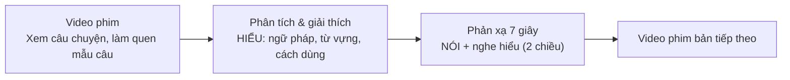

# 11. Video đi kèm mỗi bản: Phân tích & giải thích, và Phản xạ 7 giây

> Khảo sát trực tiếp ngày 17/11/2026: [Phải Giỏi Tiếng Anh](https://www.youtube.com/@phaigioitienganh) và [VocabularyHeaven](https://www.youtube.com/@Vocabulary_Heaven). Khung hình lấy từ ảnh xem trước (storyboard) của YouTube, lưu ở [assets/research/](../assets/research/).

## Kết luận

**Mỗi bản (A1, A2, B1, B2) của mỗi tình huống có 3 video, dùng chung một bộ câu:**

Lý do:

1. **Vòng học Xem → Hiểu → Nói** cho cùng một bộ câu: người học hiểu vì sao câu đúng trước khi luyện phản xạ, nên nhớ lâu hơn.
2. **Đúng thói quen học của người Việt:** thích được giải thích ngữ pháp, từ vựng bằng tiếng Việt và luyện phản xạ. Kênh Phải Giỏi Tiếng Anh đạt 89,3K người đăng ký với đúng cặp "bài học + bài thi"; trong khảo sát trước, một video luyện phản xạ 8 giây của kênh "Tiếng Anh Giao Tiếp 8S | Phản Xạ Tiếng Anh 8 Giây" có 133K view ([docs/01](01-phan-tich-kenh-tham-khao.md#thị-trường-việt-nam-khảo-sát-bổ-sung-17112026)).
3. **Xem thụ động được:** cả hai video không bắt người học làm bài viết, nên phù hợp cách xem YouTube (trên điện thoại, lúc rảnh).
4. **Gần như không tốn chi phí sáng tác mới:** câu đã có trong `episode.json`; chỉ cần LLM soạn phần giải thích, sinh giọng và render template (~$0,5/video).
5. **Ra Shorts rất tốt:** mỗi câu phản xạ 7 giây hoặc mỗi "mẹo dùng từ" là một Short.

Điều kiện: mỗi video dùng bộ câu riêng của đúng bản đó, có thương hiệu Hẻm 99, không đăng ồ ạt, và nối chặt với video phim (xem [Rủi ro](#rủi-ro-và-cách-tránh)).

## Phân tích hai kênh

| | Phải Giỏi Tiếng Anh | VocabularyHeaven |
| --- | --- | --- |
| Người đăng ký / số video | 89,3K / 177 | 11,9K / 301 |
| View mỗi video (30 video gần nhất) | 0,7K – 8,7K | 0,5K – 3,8K |
| Nhịp đăng | 3 video mỗi 1–2 tháng; video mới nhất 6 ngày trước | Video mới nhất ~1 năm trước (có vẻ đã dừng) |
| Định dạng | Series "5000 câu tiếng Anh" theo chủ đề. Mỗi phần có **3 video**: bài học (12–16 phút) + bài thi Việt→Anh + bài thi Anh→Việt (8–10 phút) | Video 30–60 phút: cấu trúc từ vựng, ngữ pháp, hỏi–đáp luyện nói, theo cấp độ A1–B1 |
| Bài học | Mỗi câu: tiếng Anh + IPA + **phiên âm kiểu Việt** ("am-xi-in-xóm-quoan") + nghĩa + khung giải thích bên phải ([khung hình](../assets/research/pgta_lesson_storyboard.png)) | **Quay màn hình gõ trực tiếp**: câu tiếng Việt in đậm cụm cấu trúc → gợi ý (*be ready for sth*) → gõ câu tiếng Anh → tô đỏ cấu trúc; cột từ vựng có IPA bên phải ([khung hình](../assets/research/vh_storyboard.png)) |
| Bài luyện phản xạ | Nghe câu tiếng Việt → **đếm ngược 7 giây** → hiện đáp án tiếng Anh ([khung hình](../assets/research/pgta_test_storyboard.png)) | Hỏi–đáp luyện nói A1A2, A2B1 (video dài 45–60 phút) |
| Hình ảnh | Slide tĩnh nền nâu, chữ màu | Bảng tính/Word quay màn hình |
| Kiếm tiền phụ | Donate qua số tài khoản | Nhóm Zalo tài liệu có phí, website |

**Điểm mạnh nên học:**

- Luật thi rõ ràng, có cảm giác "thi" → người học chủ động, xem lại nhiều lần.
- Bài học giải thích từng câu, có khung giải thích riêng bên phải → dễ theo dõi.
- Phân tích cấu trúc bằng màu, đưa "công thức" (*be ready for sth*).
- Chia nhỏ theo chủ đề, đánh số phần → người học theo được lâu dài.

**Điểm yếu cần tránh:**

- Không có nhân vật, câu chuyện → khó lan truyền, view thấp và đều đều.
- Tách 1 bài thi thành 2 video gần như trùng (Việt→Anh và Anh→Việt) → đúng kiểu nội dung lặp lại mà YouTube đang siết.
- **Phiên âm kiểu Việt** giúp người mất gốc đọc được ngay nhưng dễ tạo thói quen phát âm sai (mất âm cuối, sai trọng âm). Kênh mới dùng **audio + IPA + tô đỏ trọng âm và âm cuối**.
- Video quá dài (30–60 phút), quay màn hình thô → khó giữ chân người xem mới.

## Định dạng B — "Phân tích & giải thích" (ngữ pháp, từ vựng, cách dùng)

**Một video cho mỗi bản của mỗi tình huống**, đăng 2 ngày sau video phim, **trước** video Phản xạ 7 giây. Bố cục giống video bài học của Phải Giỏi Tiếng Anh (câu lớn bên trái, khung giải thích bên phải), nhưng phân tích sâu hơn và có thương hiệu.

Khác với phần "Học mẫu câu" trong video phim (6–8 thẻ nhanh, ~1:30): video này **đi sâu từng câu** — vì sao câu được nói như vậy, từ nào mới, dùng khi nào, khác gì câu tương tự.

### Màn hình

| Vùng | Nội dung |
| --- | --- |
| Trên cùng | "Phân tích & giải thích — Gọi phở ở quán Cô Ba — A1" + số câu (đánh số theo kênh, khớp với video phản xạ) |
| Bên trái | **Câu tiếng Anh** cỡ lớn, tô màu thành phần: **chủ ngữ** (xanh dương), **động từ** (đỏ), **tân ngữ/bổ ngữ** (vàng), **cụm cố định** (gạch chân); dưới là **IPA** (âm cuối và trọng âm tô đỏ) và **nghĩa tiếng Việt** |
| Bên phải | **Khung giải thích**, hiện lần lượt theo 4 mục bên dưới |
| Góc dưới | Tín nhỏ (puppet có sẵn, chỉ nhép miệng) hoặc chỉ giọng |
| Nền | Màu kem thương hiệu, logo Hẻm 99 |

### Chọn câu nào để phân tích — số câu **tính động** theo từng bản

**Không cố định số câu.** Số câu phân tích = số mẫu câu mục tiêu mà kịch bản của bản đó thật sự có, nên mỗi tình huống, mỗi bản một khác: cảnh "mua 1 ký xoài" A1 có thể chỉ 4 mẫu câu, cảnh "gọi phở" A1 có 6, còn "đàm phán hợp đồng" B2 có thể tới 14. Pipeline đọc `episode.json` và tự tính số khối, rồi kiểm tra theo các giới hạn bên dưới.

**Câu nào được phân tích:**

| Loại câu trong bản | Cách xử lý | Lý do |
| --- | --- | --- |
| **Mẫu câu mục tiêu mới** (thẻ P trong phim — bao nhiêu cũng được) | **Phân tích đủ 100%**, đủ 4 mục | Thiếu câu nào thì bài thi phản xạ sẽ hỏi câu người học chưa được giải thích |
| **Lỗi Vietglish** của tập (0–2 lỗi, tùy kịch bản) | Mỗi lỗi 1 khối: câu sai → vì sao sai → câu đúng | Điểm khác biệt của kênh |
| **Góc văn hóa** (nếu bản có, ví dụ "ai trả tiền" ở B1) | 1 khối ngắn | Người Việt cần hiểu khác biệt để dùng câu đúng lúc |
| **Câu ôn từ bản trước** | Không phân tích lại; 1 dòng so sánh trong mục "Cách dùng" của câu nâng cấp | Bản trước đã có video phân tích |
| **Câu phụ trong hội thoại** | Không phân tích; từ mới chỉ đưa vào bảng tổng kết | Giữ video tập trung |

**Cách tính số khối (tự động):**

1. Lấy danh sách mẫu câu mục tiêu mới của bản (N câu, N thay đổi theo kịch bản).
2. **Gom theo chức năng:** câu hỏi + câu đáp đi cùng nhau; các câu cùng việc gộp 1 khối (*Could we have the bill? / Do you have change? / Can I pay by QR code?* = khối "Tính tiền"). Mỗi khối 1–3 câu. Số khối thường ≈ N ÷ 1,5.
3. Cộng khối lỗi và khối văn hóa (nếu có).
4. Ước tính thời lượng: mỗi khối 45 giây + 20 giây cho mỗi câu thêm trong khối (+15 giây ở B1–B2 vì giải thích dài hơn); cộng 1 phút cho mở đầu, bảng tổng kết, kết thúc.
5. So với giới hạn của bản:

| Bản | Mẫu câu mục tiêu (gợi ý khi viết kịch bản) | Số khối | Thời lượng video |
| --- | --- | --- | --- |
| A1 | 4–8 | 3–7 | 4–9 phút |
| A2 | 6–10 | 4–8 | 5–10 phút |
| B1 | 8–12 | 5–8 | 7–12 phút |
| B2 | 10–14 | 6–9 | 8–14 phút |

**Khi vượt giới hạn:**

- **Quá dài / quá nhiều khối** → (a) gộp tiếp các khối gần nhau; (b) chuyển câu chỉ khác nhau một từ vựng xuống bảng tổng kết; (c) vẫn quá → báo lại bước viết kịch bản để giảm mẫu câu mục tiêu. Không cắt bớt câu khỏi video phân tích khi câu đó vẫn còn trong bài thi phản xạ.
- **Quá ngắn** (ví dụ A1 chỉ 3 mẫu câu) → giữ video ngắn; có thể thêm 1–2 khối "mở rộng" (biến thể hữu ích của mẫu câu chính) nhưng không độn nội dung.

Nguyên tắc chung: **người học chỉ nên nhớ khoảng 4–8 ý lớn mỗi video** — vừa sức một lần xem; thời lượng đi theo nội dung, không theo một con số cố định.

### Mỗi khối (~45–90 giây)

| Mục | Nội dung | Ví dụ (A1: *Beef pho, please.*) |
| --- | --- | --- |
| 1. Nghe câu | Giọng nhân vật trong phim đọc câu (tái dùng audio) + IPA + nghĩa | *Beef pho, please.* /biːf fʌ pliːz/ — Cho tôi phở bò. |
| 2. Ngữ pháp & cấu trúc | Thành phần câu, "công thức", so sánh trật tự từ với tiếng Việt | Tiếng Việt "phở **bò**" (món trước, loại sau) → tiếng Anh "**beef** pho" (loại trước). Công thức: *[loại] + [món], please.* |
| 3. Từ vựng | Từ mới: loại từ, IPA, nghĩa, cụm từ hay đi kèm | *beef* (n) /biːf/ thịt bò — không đếm được: *more beef*, không nói *many beef* |
| 4. Cách dùng | Dùng khi nào, mức lịch sự, câu tương đương và khác biệt; lỗi người Việt hay mắc | Gọi món ngắn gọn, lịch sự nhờ *please*. Tương đương: *I'd like beef pho* (lịch sự hơn), *Can I get beef pho?* (thân mật). Lỗi hay gặp: *Pho beef, please* ❌ |

### Cấu trúc video

| Phần | Nội dung | Thời lượng |
| --- | --- | --- |
| Mở đầu | Tín: "Hôm nay mình phân tích kỹ [N] mẫu câu trong phim — vì sao nói vậy, dùng khi nào." Nhắc lại 5 giây cảnh phim | 15 giây |
| Phân tích từng khối | Đủ mẫu câu mục tiêu của bản, số khối tính động (xem trên), mỗi khối đủ 4 mục | 3–12 phút |
| Bảng tổng kết | Một màn hình gom **từ vựng** (từ, IPA, nghĩa) + **công thức câu** — giữ 5 giây để người học chụp màn hình | 30 giây |
| Kết thúc | "Câu nào bạn hay nói sai? Bình luận nhé" + end screen sang video Phản xạ 7 giây cùng bản | 15 giây |

### Nâng dần theo bản

| Bản | Mẫu câu → khối (tùy bản) | Thời lượng | Trọng tâm giải thích | Ngôn ngữ giải thích |
| --- | --- | --- | --- | --- |
| A1 | 4–8 → 3–7 khối | 4–9 phút | Trật tự từ (*phở bò* → *beef pho*), câu hỏi Yes/No với *is*, *How much is…?*, danh từ đếm được/không đếm được | Tiếng Việt |
| A2 | 6–10 → 4–8 khối | 5–10 phút | Mức lịch sự *Can I get / Could I have / I'd like*; quá khứ đơn (*I ordered*); *less / no*; hỏi sự khác nhau | Tiếng Việt |
| B1 | 8–12 → 5–8 khối | 7–12 phút | Mô tả món (*filled with*), so sánh (*similar to…, but*), làm mềm câu (*I'm afraid*), hiện tại hoàn thành, điều kiện + *might* | Tiếng Việt, xen ví dụ tiếng Anh |
| B2 | 10–14 → 6–9 khối | 8–14 phút | Ngôn ngữ đàm phán (*provided that*, *If we were to…*), nói giảm nói tránh, từ vựng hợp đồng (*deposit, upfront, non-refundable*), khác biệt Anh–Úc–Mỹ (*mum, brilliant*) | Tiếng Việt, thuật ngữ kèm tiếng Anh |

Video này giải thích bằng tiếng Việt ở mọi bản vì đây là video bài giảng. Video phim mới là nơi giảm dần tiếng Việt theo trình độ.

## Định dạng A — "Phản xạ 7 giây" (luyện nói)

**Làm theo cách của kênh Phải Giỏi Tiếng Anh** — dạng **bài thi 2 chiều** trong cùng một video: **Phần 1 Việt → Anh** (nghe câu tiếng Việt → 7 giây nói câu tiếng Anh → hiện đáp án) và **Phần 2 Anh → Việt** (nghe câu tiếng Anh → 7 giây nói nghĩa tiếng Việt → hiện đáp án). Không có hoạt cảnh nhân vật, không chen hài, người học chỉ tập trung phản xạ. Khung hình tham khảo: [assets/research/pgta_test_storyboard.png](../assets/research/pgta_test_storyboard.png).

**Một video cho mỗi bản (A1, A2, B1, B2) của mỗi tình huống**, đăng 2 ngày sau video Phân tích & giải thích.

### Màn hình (cố định suốt video)

| Vùng | Nội dung |
| --- | --- |
| Trên cùng | Tên bài thi: **"Bài thi phản xạ 7 giây — Gọi phở ở quán Cô Ba — A1"** + logo Hẻm 99 |
| Dưới tên bài (luôn hiện) | **Luật thi** theo phần. Phần 1: "Bạn sẽ nghe 1 câu tiếng Việt. Trong 7 giây, hãy nói to câu tiếng Anh. Sau 7 giây chưa nói được nghĩa là chưa đạt — thi lại đến khi đạt 100%." Phần 2: "Bạn sẽ nghe 1 câu tiếng Anh. Trong 7 giây, hãy nói nghĩa tiếng Việt." |
| Góc trên | Nhãn phần: **PHẦN 1 · VIỆT → ANH** / **PHẦN 2 · ANH → VIỆT** |
| Giữa | **Số thứ tự câu** + câu đề (hộp đỏ): tiếng Việt ở Phần 1, tiếng Anh ở Phần 2 |
| Dưới | **Đồng hồ đếm ngược** 00:07 → 00:00 |
| Sau 7 giây | Đáp án (hộp vàng), hiện ngay dưới câu đề |
| Nền | Ảnh Quán Cô Ba làm mờ + màu thương hiệu (thay cho nền trơn của kênh tham khảo) |

### Nhịp mỗi câu (~13 giây)

| Bước | Phần 1 · Việt → Anh (luyện nói) | Phần 2 · Anh → Việt (luyện nghe hiểu) |
| --- | --- | --- |
| 1. Đề (2–3 giây) | Câu tiếng Việt + **giọng Tín** đọc | Câu tiếng Anh + **giọng nhân vật trong phim** đọc (chữ có thể ẩn ở bản B1–B2 để luyện nghe thuần) |
| 2. Suy nghĩ (7 giây) | Đồng hồ đếm, người học **nói to câu tiếng Anh** | Đồng hồ đếm, người học **nói nghĩa tiếng Việt** |
| 3. Đáp án (3 giây) | Câu tiếng Anh + giọng nhân vật đọc 1 lần | Câu tiếng Việt + giọng Tín đọc |

Phần 2 dùng **cùng bộ câu của Phần 1 nhưng xáo thứ tự**, để người học không nhớ theo vị trí. Audio đã có sẵn từ Phần 1, nên Phần 2 gần như không tốn thêm chi phí.

### Số câu và thời lượng

| Bản | Số câu | Thời lượng (Phần 1 + Phần 2) | Nguồn câu |
| --- | --- | --- | --- |
| A1 | 25 | ~11:30 | Câu trong phim + biến thể thay 1 từ (*No onions* → *No ice*) |
| A2 | 30 | ~13:30 | Câu A2 trong phim + biến thể |
| B1 | 35 | ~15:45 | Câu B1 (gợi ý, giải thích, xin lỗi) + biến thể |
| B2 | 35 | ~16:00 | Câu B2 dài hơn; đồng hồ vẫn 7 giây |

Video có **chapters** "Phần 1 · Việt → Anh" và "Phần 2 · Anh → Việt" để người học nhảy thẳng tới phần cần luyện.

**Mở đầu (10 giây):** Tín đọc luật thi Phần 1. **Chuyển phần (10 giây):** "Phần 2: đổi chiều! Nghe tiếng Anh, nói nghĩa tiếng Việt." **Kết thúc (15 giây):** "Phần 1 bạn được mấy câu, Phần 2 được mấy câu? Bình luận điểm của bạn!" + end screen sang video phim của bản tiếp theo.

**Đánh số câu liên tục toàn kênh** (giống series "5000 câu" của kênh tham khảo): Gọi phở A1 là câu 1–25, A2 là câu 26–55… Người học thấy tiến độ ("đã luyện 300 câu"), và về sau gom thành sách/PDF "1000 câu giao tiếp Hẻm 99". Video Phân tích dùng cùng số câu để người học tra lại.

**Vì sao gộp 2 chiều vào một video:** kênh tham khảo tách thành 2 video thi riêng (Việt → Anh và Anh → Việt) với cùng bộ câu. Gộp lại giúp tránh 2 video gần trùng nội dung (rủi ro chính sách nội dung lặp lại) và tăng thời gian xem mỗi video. Nếu sau này muốn tách như kênh tham khảo, pipeline chỉ cần render 2 file từ cùng dữ liệu.

## Lịch đăng cho mỗi bản

| Ngày | Video | End screen trỏ tới |
| --- | --- | --- |
| Ngày 0 | Video phim | Phân tích & giải thích cùng bản |
| Ngày +2 | Phân tích & giải thích | Phản xạ 7 giây cùng bản |
| Ngày +4 | Phản xạ 7 giây | Video phim của bản tiếp theo (cùng tình huống) |
| Ngày +1 → +6 | 3–5 Shorts (1 câu phản xạ hoặc 1 mẹo dùng từ) | Video phim |

**Playlist:** thêm "Phân tích & giải thích" và "Luyện phản xạ 7 giây" (mỗi playlist chia theo trình độ A1–B2), ngoài playlist tình huống, chủ đề và lộ trình đã có.

## Ảnh hưởng tới sản lượng và chi phí

| | Chỉ video phim | Phim + 2 video đi kèm |
| --- | --- | --- |
| Video dài cho 1 tình huống (4 bản) | 4 | 12 (+1 tổng hợp) |
| Video dài cho 48 tình huống | 192 | 576 |
| Video dài/tháng (8–12 video phim) | 8–12 | 24–36 |
| Chi phí thêm cho mỗi video đi kèm | — | ~$0,5 (LLM soạn giải thích + giọng ~2.000–4.000 ký tự + thumbnail; không ảnh nền mới, không AI video) |
| Giờ công thêm cho mỗi video đi kèm | — | Phản xạ ~0,5 giờ (duyệt câu); Phân tích ~1–1,5 giờ (duyệt kỹ phần giải thích ngữ pháp) |

**Triển khai theo giai đoạn:**

1. **Từ đầu:** mỗi bản của mỗi tình huống có đủ **Phân tích & giải thích** và **Phản xạ 7 giây**.
2. **Sau 6–8 tuần** (khoảng 2 tình huống): so sánh view, thời gian xem, bình luận của từng loại video.
3. Loại nào có hiệu suất thấp hơn 30% so với video phim → giảm tần suất hoặc gộp vào video phim.

## Rủi ro và cách tránh

| Rủi ro | Cách tránh |
| --- | --- |
| **Chính sách "inauthentic content"** — video template lặp lại là đúng nhóm YouTube đang siết | Mỗi video có bộ câu riêng của đúng bản đó, đánh số liên tục toàn kênh (không câu nào lặp lại giữa các video); phần giải thích được soạn riêng cho từng câu; giọng nhân vật và nền thương hiệu; không tách một bài thành nhiều video gần trùng; giữ nhịp đăng ≤ 1 video/ngày |
| **Giải thích ngữ pháp sai** — lỗi nặng nhất với video bài giảng | Editor-LLM kiểm tra + bạn duyệt từng câu giải thích; tra lại bằng từ điển (Cambridge, Oxford Learner's) khi có từ mới; về sau nhờ giáo viên duyệt |
| Video đi kèm kéo chỉ số trung bình của kênh xuống (CTR thấp hơn video phim) | Thumbnail riêng cho từng loại (kính lúp "phân tích", đồng hồ "7 giây"); theo dõi riêng theo playlist; điều chỉnh tỉ lệ sau 2 tháng |
| Khán giả xem video đi kèm không xem phim và ngược lại | End screen, thẻ (card) và mô tả luôn nối 3 video cùng bản |
| Đáp án sai trên video "thi" làm mất uy tín | Đáp án lấy từ kịch bản đã duyệt; biến thể mới qua editor-LLM + bạn duyệt |
| Tăng khối lượng việc | Sinh tự động từ `episode.json` + `situation.json`; người chỉ duyệt |

## Tự động hóa

Pipeline thêm 2 bước sau khi video phim được duyệt ([08-tu-dong-hoa.md](08-tu-dong-hoa.md)):

1. `practice:analysis` — lấy **toàn bộ** mẫu câu mục tiêu mới + lỗi Vietglish của bản → LLM gom khối theo chức năng → tính số khối và ước tính thời lượng, cảnh báo nếu vượt giới hạn của bản → LLM soạn JSON cho từng câu: thành phần câu (để tô màu), IPA, nghĩa, công thức, từ vựng (loại từ, IPA, nghĩa), cách dùng, câu tương đương, lỗi hay gặp → editor-LLM kiểm tra → **bạn duyệt** → TTS giọng Tín (giải thích) + tái dùng audio nhân vật (câu gốc) → render template `SentenceBreakdown` + `SummaryBoard`.
2. `practice:reflex` — lấy các câu `highlight` + `situation_phrases` của bản đó → LLM sinh biến thể (thay 1–2 từ) đúng CEFR, kèm câu tiếng Việt tự nhiên → editor-LLM kiểm tra → **bạn duyệt danh sách** → gán số câu liên tục toàn kênh → TTS (giọng Tín đọc câu tiếng Việt, giọng nhân vật gốc đọc đáp án; tái dùng audio của phim nếu câu trùng) → render template `ReflexDrill` (màn hình bài thi cố định, 2 phần) → Shorts.

Mẫu cho "Gọi phở ở quán Cô Ba" bản A1: [phan-tich-giai-thich.md](../video-mau/chu-de-an-uong/th01-goi-pho-quan-co-ba/A1/phan-tich-giai-thich.md) và [luyen-phan-xa-7s.md](../video-mau/chu-de-an-uong/th01-goi-pho-quan-co-ba/A1/luyen-phan-xa-7s.md). Tiến triển qua 4 bản: [README tình huống](../video-mau/chu-de-an-uong/th01-goi-pho-quan-co-ba/README.md#luyện-tập-tăng-dần-qua-4-bản).
