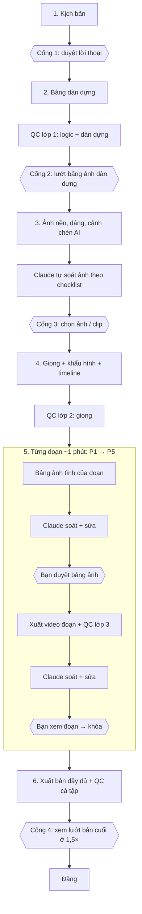

# 13. Quy trình sản xuất có kiểm soát chất lượng (QC)

Mục tiêu: **người duyệt không phải tự soi lỗi**. Mọi lỗi kỹ thuật và lỗi "không hợp lý ngoài đời" phải được máy hoặc Claude bắt trước khi video đến tay người duyệt. Người duyệt chỉ quyết định về nội dung và gu.

Tài liệu này bổ sung cho [05-quy-trinh-san-xuat.md](05-quy-trinh-san-xuat.md) (làm gì ở từng bước) và [08-tu-dong-hoa.md](08-tu-dong-hoa.md) (kiến trúc). Lệnh chạy cụ thể ở [pipeline/README.md](../pipeline/README.md).

## Vì sao cần

Video A1 đầu tiên ("Gọi phở ở quán Cô Ba") đạt mọi phép đo kỹ thuật, nhưng người duyệt vẫn phải tự bắt 9 lỗi, ví dụ nhân vật bay trên bàn, thừa ghế, nhún lên xuống, nhìn sai người. Đây đều là lỗi **dàn dựng**: ai đứng đâu, ngồi trên gì, nhìn ai, cầm gì. Quy trình cũ không có bước nào kiểm tra dàn dựng. Toàn bộ lỗi được ghi trong [Sổ lỗi](#sổ-lỗi).

## Luồng sản xuất



### Làm theo từng đoạn ~1 phút

Không xuất cả video rồi mới sửa. Mỗi tập chia thành các đoạn theo ranh giới cảnh (khai báo trong `episode.json` → `segments`; A1 có 5 đoạn P1–P5, 46–63 giây). Mỗi đoạn qua 2 lần duyệt nhẹ:

1. **Bảng ảnh tĩnh** (`segment.mjs board`): mỗi câu 1 ảnh, khoảng 40 giây là có, chưa cần xuất video. Phần lớn lỗi dàn dựng thấy ngay ở đây.
2. **Video của đoạn** (`segment.mjs render`): khoảng 1,5 phút xuất + QC lớp 3; bạn xem 1 phút.

Đoạn đã duyệt được **khóa** (`segment.mjs approve`): lưu dấu vân tay (nội dung timeline + mọi file hình, tiếng của đoạn). Sửa gì làm đoạn đã khóa thay đổi thì `segment.mjs status` báo "cần duyệt lại", nên không có thay đổi nào lọt qua mà không ai xem. Khi cả 5 đoạn đã khóa mới xuất bản đầy đủ một lần và chạy QC cả tập.

Hình lục giác là cổng người duyệt. **Quy tắc vàng:** Claude chỉ báo "xong" khi QC lớp 3 toàn ✅ và bảng ảnh đã được soát theo checklist bên dưới. Lỗi nào tự sửa được thì sửa và xuất lại trước, không đẩy cho người duyệt.

## Các bước và điều kiện "xong"

| Bước | Ai làm | Xong khi |
| --- | --- | --- |
| 1. Kịch bản | Claude viết, LLM editor soát CEFR | Người duyệt đọc to và đồng ý (cổng 1) |
| 2. Bảng dàn dựng | Claude | Mỗi shot puppet có đủ: ai có mặt (vào/ra ở câu nào), dáng (đứng/ngồi/sau bàn), nói với ai, đạo cụ ai cầm, ảnh nền chứa gì. QC lớp 1 không còn ⚠️ chưa giải thích |
| 3. Tạo hình | Claude tạo, tự loại bản lỗi | Ảnh qua checklist "ảnh AI"; người duyệt chọn bản (cổng 3) |
| 4. Giọng, khẩu hình | Máy | Không câu nào lệch kịch bản; build timeline không còn cảnh báo chưa xử lý |
| 5. Xuất video | Máy + Claude | QC lớp 3 toàn ✅, bảng ảnh đã soát, lỗi đã sửa |
| 6. Duyệt cuối | Người duyệt | Xem 1 lượt ở 1,5× (cổng 4) |

## Ba lớp tự kiểm tra

### Lớp 1: logic và dàn dựng (trước khi tốn tiền tạo giọng, xuất video)

| Kiểm tra | Trạng thái |
| --- | --- |
Chạy bằng `node scripts/stage-lint.mjs <episodeDir>` (tự chạy trong `segment.mjs board`). Kết quả chia 3 mức: ❌ lỗi (phải sửa), ⚠️ không hợp lý, 🧩 thiếu tài sản (kèm danh sách cần tạo).

| Kiểm tra | Trạng thái |
| --- | --- |
| Ai nói thì phải có mặt; nhân vật chỉ có mặt từ câu mình vào (`enter`) đến câu mình ra (`exit`), vào/ra bằng bước vào từ mép khung | ✅ |
| Không đứng chắn bàn/khách: mỗi ảnh nền có vùng cấm đứng (`no_stand` trong `staging.json`) | ✅ |
| Hai người đứng không chồng lên nhau (khoảng cách ≥ bề ngang thân người) | ✅ |
| Đạo cụ "trên bàn" (`props[].on`) phải có trong ảnh nền (`contains`) | ✅ |
| Đạo cụ "cầm tay" (`props[].holder`, có `from`/`until` theo câu) và cử chỉ phải có ảnh dáng đúng tư thế (đứng/ngồi); thiếu thì giữ dáng gần nhất, không tự đứng dậy | ✅ |
| Cử chỉ thoáng qua (vẫy, chỉ…) chỉ kéo dài trong câu của mình; cầm đồ (`hold_*`) thì giữ tiếp | ✅ |
| Liên tục: cảnh chèn AI cho thấy gì (`shows`) thì cảnh ngay sau phải có | ✅ |
| Thẻ mẫu câu thiếu bản dịch riêng (`phrases[].vi`) | ✅ |
| Mặt không bị cắt mép, không nằm dưới hộp phụ đề; tỉ lệ chiều cao giữa các nhân vật | sắp làm |

Dữ liệu dàn dựng nằm ở: `assets/locations/<loc>/v1/staging.json` (ảnh nền chứa gì, vùng cấm đứng, chỗ ngồi), mục `staging` trong `rig.json` của mỗi dáng (tư thế, cử chỉ, đồ đang cầm), `pipeline/src/slots.json` (vị trí ngang các slot, bề ngang thân người).

### Lớp 2: giọng

| Kiểm tra | Trạng thái |
| --- | --- |
| Nhận dạng giọng (ASR, ElevenLabs Scribe) so với chữ mong đợi: `node scripts/asr-check.mjs <audioDir> <id=chữ> …` hoặc `--reflex <reflex.json>`. Lệch do chữ số (60,000) hay tên riêng (pho) thì ghi chú, còn lại đọc lại | ✅ |
| Tốc độ đọc đúng cấp (A1 chậm), khoảng nghỉ giữa các lượt | sắp làm |

### Lớp 3: video đã xuất (`scripts/qc-video.py`)

| Kiểm tra | Chuẩn |
| --- | --- |
| Âm lượng tích hợp | −16 LUFS ±1, true peak ≤ −1 dBFS |
| Đoạn im lặng | không có đoạn nào > 1,5 s dưới −45 dB |
| Khung đen | không có đoạn nào > 0,3 s |
| Độ dài | khớp timeline ±0,2 s |
| Rung/nhún trong cảnh puppet | < 0,6 lần đổi hình/giây và trung vị thay đổi < 0,05% khung. Đã thử trên A1: bản bị nhún đo được 1,4–2,2 lần/giây, bản đứng yên 0,04–0,34 lần/giây |
| Phụ đề tiếng Anh | ≤ 42 ký tự mỗi câu |
| **Bảng ảnh từng câu** | 1 ảnh giữa mỗi câu thoại, cảnh chèn và câu đố, 16 ảnh mỗi trang, có nhãn thời điểm, shot, câu và người nói |

Kết quả nằm trong `pipeline/out/qc/<tên-bản>/`: `report.md`, `report.json` và `sheet-NN.png`.

## Dàn dựng: trả lời trước khi làm bảng ảnh

Với **mỗi shot puppet**, Claude trả lời đủ 8 câu dưới đây khi viết bảng dàn dựng (bước 2), không để đến lúc người duyệt nhìn thấy lỗi. Cột cuối cho biết ai kiểm tra: ✅ máy (`stage-lint.mjs`) hay 👁 Claude soát trên bảng ảnh.

| # | Câu hỏi | Quy tắc | Kiểm tra |
| --- | --- | --- | --- |
| 1 | **Xa gần (chiều sâu)**: ai ở tiền cảnh, ai lùi phía sau? | Người ngồi ở bàn quán lùi phía sau (`seat.depth` = 0,65); người đứng là tiền cảnh (1,0). Người ở trước to hơn và có thể bị cắt chân | ✅ |
| 2 | **Vị trí so với đồ vật**: đứng ở đâu so với bàn, quầy, cửa? | Không đứng chắn bàn, khách hay đồ quan trọng (`no_stand`). Người phục vụ đứng **sát đầu bàn** (`beside-table`), không đứng giữa sân. Khách gọi món ở quầy đứng **sát tủ kính**, gần chủ quán (người duyệt chọn, S01) | ✅ |
| 3 | **Khoảng cách giao tiếp**: hai người nói chuyện có đủ gần không? | Người đang nói chuyện với nhau cách nhau ≤ 50% khung hình. Hai người đứng không chồng vai quá mức | ✅ |
| 4 | **Hướng người (thân)**: thân quay về đâu? | Người **phía trước** nói với người **phía sau** thì xoay nghiêng cả người về phía họ (`facing: profile`); người phía sau giữ 3/4. Người nghe cũng quay về người đang nói | ✅ |
| 5 | **Đường nhìn**: mắt nhìn đúng mặt người kia chưa? | Đo trên khung hình: chỉ cúi hoặc ngước khi đường mắt lệch > 20°; còn lại nhìn ngang. Nhìn đúng người nghe (`to` khi khác người vừa nói) | ✅ |
| 6 | **Tư thế**: dáng có tự nhiên không? | Đầu, vai, ngực, tay, chân **xoay cùng hướng** (không vặn cổ). Ngồi hay đứng hợp ngữ cảnh. Cử chỉ thoáng qua hết khi hết câu, cầm đồ thì giữ tiếp | ✅ một phần / 👁 |
| 7 | **Đạo cụ và trạng thái cảnh**: trên bàn, trên tay có gì ở câu này? | Lời nói khớp hành động ("Here you are" mang món ra thì món có trên bàn). Cảnh chèn cho thấy gì thì cảnh sau phải có | ✅ |
| 7a | **Tay gặp tay**: đưa và nhận đồ thì đồ có nằm trên lòng bàn tay người nhận không? | Đo trên khung: lệch ngang ≤ 70 px, đồ cao hơn lòng bàn tay 0–140 px; tay người đưa vẽ đè lên | ✅ |
| 7b | **Phản ứng người nghe**: người nghe có làm gì khớp với câu kia không? | Câu có hành động hướng tới người khác (đưa tiền, đưa món, chào) thì người nhận phản ứng: ghi `"react": { "<id>": "<cử chỉ>" }` trong câu đó (vd. L24 Jake đưa tiền → Tín `receive`) | ✅ |
| 8 | **Vào/ra cảnh**: ai đã đến, ai đã đi? | Nhân vật chỉ có mặt từ câu mình vào (`enter`) đến câu mình ra (`exit`) | ✅ |

Khi có tình huống mới mà quy tắc chưa rõ (ví dụ hai người cùng ngồi, nói qua quầy, đi ngang qua), Claude dựng **2–3 phương án tại đúng vị trí** rồi cho người duyệt chọn trên ảnh, không đoán. Lựa chọn đó được ghi lại thành quy tắc mới trong bảng này.

## Checklist "hợp lý ngoài đời"

Claude soát từng ảnh trên bảng theo danh sách này trước khi báo người duyệt. Mỗi mục kèm lỗi thật đã gặp, để nhớ vì sao mục đó có mặt.

| Nhóm | Câu hỏi | Lỗi đã gặp |
| --- | --- | --- |
| Có mặt | Ai đang trong khung? Người đó đã đến chưa, hay đã đi chưa? | Tony đứng sẵn trước khi chạy tới |
| Vật lý | Chân chạm sàn hoặc ghế? Có ai lơ lửng hay mất nửa người? Ngồi thì có ghế không? | Jake bay trên bàn |
| Trùng vật | Có vật nào xuất hiện 2 lần (nền đã có + nhân vật mang theo)? | 2 cái ghế |
| Dáng | Dáng có liền mạch giữa các câu không? Đang ngồi có tự đứng dậy không? | Jake đứng dậy khi vẫy tay |
| Xa gần | Người ở trước và người ở sau có rõ ràng không? Người phía trước có quay mặt ra khán giả trong khi nói với người phía sau không? | Tín đứng tiền cảnh nói với Jake ngồi phía sau mà mặt quay ra trước |
| Hướng nhìn | Người nói nhìn đúng người nghe, đúng tầm mắt **trên khung hình**? Nhân vật ở góc nhìn vào nội dung? | Tín nhìn Tony khi trả lời Jake; Tín cúi 20° trông như nhìn đất; khung tròn nhìn ra ngoài |
| Tư thế | Đầu và thân xoay cùng hướng? Có ai bị vặn cổ, vặn người không? | Tín đầu nghiêng, thân 3/4 |
| Đạo cụ | Kịch bản nói cầm gì thì trên hình có cầm không? | Sổ ghi món, tờ 60k chưa vẽ |
| Tỉ lệ | Chiều cao các nhân vật có hợp lý với nhau và với đồ vật không? | — |
| Chữ, số | Biển số, chữ trong ảnh AI đúng không (nhà 99)? Có vẽ giả nút/thẻ link mà YouTube đã có (Cards, End screen) không? | Biển số sai trong V-A, V-C |
| Nội dung học | Bản dịch tiếng Việt khớp đúng câu tiếng Anh trên thẻ? Phát lại đủ cặp hỏi–đáp, và câu nào phát lại thì có trên thẻ? Khung tròn là đúng người đang nói? Chỉ tô vàng cụm **đang** được nói (từng nửa, không tô cả cặp)? Chữ đủ to để đọc trên điện thoại? | Thẻ "Is it spicy?" ghi "Cảm ơn! Ừm… Có cay không?" |
| Chuyển động | Nhân vật đứng yên, chỉ miệng và mắt cử động? Không ai chớp mắt cùng lúc? | Nhún; cả nhóm chớp mắt cùng lúc |
| Âm thanh | Cảnh nào im? Tiếng động khớp hành động? | Cảnh chèn im 3–4 s |

### Checklist ảnh AI (bước 3, trước khi chọn hoặc tạo video)

- Đúng nhân vật (mặt, tóc, trang phục theo hero), đúng số người, không thừa tay chân.
- **Đầu và thân xoay cùng hướng**: dáng nghiêng thì vai, ngực, tay, bàn chân cũng nghiêng (so với bảng xoay nhân vật `sheet.png`); đầu nghiêng mà thân 3/4 là vặn cổ.
- Không có chữ hoặc số do AI vẽ. Nếu có thì phải đúng (biển nhà là "99") hoặc che bằng code.
- Ảnh nền cho chỗ ngồi **không có ghế**, vì dáng ngồi đã mang ghế theo.
- Ánh sáng và góc máy khớp với ảnh nền cùng location.
- Duyệt **ảnh keyframe** trước khi tạo video: sửa ảnh rẻ hơn tạo lại video rất nhiều.
- Sau **mỗi lần AI sửa ảnh**, đối chiếu đủ từng món trong `contains` của ảnh đó: AI hay làm mất hoặc thay món khác khi thêm món mới.

## Vòng học từ lỗi

Mỗi lỗi, dù người duyệt hay Claude phát hiện, đều đi đủ 5 bước. Chưa xong bước 5 thì chưa coi là sửa xong.

1. **Sửa** chỗ sai trong tập đang làm.
2. **Ghi Sổ lỗi**: lỗi gì, ai bắt, **nguyên nhân gốc** (vì sao quy trình để lọt, không chỉ "vẽ sai"), quy tắc mới.
3. **Chặn ở đâu**, chọn mức mạnh nhất làm được:
   - **Máy kiểm tra** (`stage-lint.mjs`, `qc-video.py`): lỗi đo được (vị trí, khoảng cách, đường nhìn, đạo cụ, âm thanh).
   - **Checklist** (bảng Dàn dựng / hợp lý ngoài đời / ảnh AI): lỗi cần mắt nhìn.
   - **Hướng dẫn prompt** ([prompts/character-sheet.md](../prompts/character-sheet.md)): lỗi do AI tạo ảnh.
4. **Ca kiểm tra tái hiện** trong `pipeline/tests/regressions.mjs`: dựng lại đúng tình huống sai cũ và yêu cầu máy phải báo. `npm run check` chạy tất cả; ca nào hỏng nghĩa là lớp bảo vệ bị phá, phải sửa trước khi làm tiếp.
5. **Bộ nhớ Claude** (chỉ khi là bài học về cách làm việc, không phải chi tiết của một tập): ghi vào memory để phiên sau, máy sau cũng biết.

**Đầu mỗi tập mới:** Claude đọc Sổ lỗi và các bài học bên dưới, chạy `npm run check`, rồi mới viết bảng dàn dựng.
**Cuối mỗi tập:** viết 3–5 dòng tổng kết vào mục "Bài học theo tập" và đếm số lỗi người duyệt phải tự bắt. Mục tiêu là con số này giảm dần.

### Bài học theo tập

**A1 "Gọi phở ở quán Cô Ba" (2026-11-17 → 18) — xong, bản cuối `pipeline/out/a1-full-v5.mp4` (4:40, −16,0 LUFS, QC toàn ✅):** 34 lỗi.

| Giai đoạn | Người duyệt bắt | Claude/máy bắt |
| --- | --- | --- |
| Trước quy trình QC (#1–9, xuất cả video rồi xem) | 7 | 2 |
| Sau quy trình QC (#10–34, bảng ảnh từng đoạn + kiểm tra tự động) | 8 | 17 |

- Lỗi lớn nhất là **dàn dựng**: vị trí, xa gần, hướng người, đường nhìn, tay gặp tay. Cách chữa: đo bằng hình học trên khung hình, không đoán theo tư thế. Khi chưa rõ, dựng 2–3 phương án để người duyệt chọn.
- **Ảnh AI** hay làm mất món khi sửa, xoay đầu mà không xoay thân, vẽ miệng hở. Cách chữa: sửa từ ảnh dáng gốc, đối chiếu `contains`, so với bảng xoay.
- **Phần học** cần khớp chữ–tiếng từng nửa câu: câu nào phát lại thì có trên thẻ, chỉ tô vàng nửa đang được nói (dùng mốc thời gian từng ký tự của TTS).
- **Âm thanh**: chuẩn hóa từng câu sau TTS và master cả bản xuất; đoạn không lời (đếm ngược, màn hình cuối) cần nhạc đủ nghe.
- **Không vẽ giả** thứ YouTube đã có (Cards, End screen); ghi vào `publish.youtube_studio`.
- **Công cụ trung gian** (ChatGPT) có thể nối nhầm prompt → kiểm tra ô nhập và `params.prompt`.
- Duyệt bảng ảnh tĩnh từng đoạn trước khi xuất video rút vòng sửa từ ~7 phút xuống ~40 giây.
- **Mục tiêu tập sau:** người duyệt bắt ≤ 4 lỗi. 8 lỗi người duyệt còn bắt được ở giai đoạn sau đều đã có luật hoặc ca kiểm tra.

## Sổ lỗi

Mỗi lỗi được phát hiện (do người duyệt hay Claude) **phải** có một dòng ở đây, kèm quy tắc mới và nơi kiểm tra tự động. Lỗi nào kiểm tra được bằng máy thì có ca tái hiện cùng số `#` trong `pipeline/tests/regressions.mjs`. Mục tiêu là mỗi lỗi chỉ xảy ra một lần.

| # | Ngày | Lỗi | Ai bắt | Nguyên nhân | Quy tắc / cách sửa | Kiểm tra ở đâu |
| --- | --- | --- | --- | --- | --- | --- |
| 1 | 2026-11-17 | Jake "bay" trên bàn | Người duyệt | Nhân vật ngồi được đặt như người đứng | Ngồi = dùng dáng `poses/seated` đặt đúng vị trí ghế | `Episode.tsx` (`SEATED`) |
| 2 | 2026-11-17 | Mất nửa người dưới | Người duyệt | Cắt thân sau mép bàn | Không cắt thân; ngồi thì dùng dáng ngồi | Checklist: Vật lý |
| 3 | 2026-11-17 | Thừa 1 cái ghế | Người duyệt | Ảnh nền có ghế + dáng ngồi cũng có ghế | Ảnh nền chỗ ngồi không vẽ ghế | storyboard; sắp có: `contains` của ảnh nền |
| 4 | 2026-11-17 | Nhân vật nhún lên xuống | Người duyệt | Hiệu ứng thở/gật (chỉ 0,3% đã lệch 11 px) | Nhân vật đứng yên; chỉ miệng và mắt động | `qc-video.py`: rung/nhún |
| 5 | 2026-11-17 | Chớp mắt cùng lúc | Người duyệt | Mỗi nhân vật có lịch chớp riêng | Một lịch chung, chia lần lượt | `Character.tsx` |
| 6 | 2026-11-17 | Tín nhìn Tony khi trả lời Jake | Người duyệt | Chỉ lật nhân vật đứng bên phải | Nhân vật quay về người đang nói chuyện với mình; khi cần thì ghi `"to"` | `Episode.tsx` (`lookAt`) |
| 7 | 2026-11-17 | Tín trong khung tròn nhìn ra ngoài | Người duyệt | Hero vẽ hướng phải, khung ở góc phải | Nhân vật ở góc nhìn vào nội dung | `Shots.tsx` (`HostBubble`) |
| 8 | 2026-11-17 | Biển số nhà sai | Claude | AI vẽ số tùy ý | Không tin chữ hoặc số AI vẽ; che bằng biển "99" | `Episode.tsx` (`PLATE_FIX`); checklist ảnh AI |
| 9 | 2026-11-17 | Cảnh chèn im 3–4 s | Claude | Cảnh chèn không có tiếng nền | Mọi cảnh chèn đều có tiếng phố | `qc-video.py`: đoạn im |
| 10 | 2026-11-18 | Jake đang ngồi bỗng đứng dậy khi vẫy tay | Claude (bảng ảnh) | Cử chỉ chưa có ảnh dáng nên quay về ảnh đứng | Thiếu dáng thì giữ dáng hiện tại và cảnh báo | `build-timeline.mjs` |
| 11 | 2026-11-18 | Thẻ mẫu câu dịch cả câu gốc | Claude (bảng ảnh) | Lấy bản dịch của cả câu thoại | Mỗi mẫu câu có `vi` riêng | `build-timeline.mjs` (cảnh báo) |
| 12 | 2026-11-18 | Tony có mặt trước khi chạy tới | Claude (rà kịch bản) | Chưa có khái niệm vào/ra cảnh | Thêm `enter`/`exit` cho nhân vật | sắp làm (lớp 1) |
| 13 | 2026-11-18 | 8 cử chỉ và 3 đạo cụ trong kịch bản không hiện trên hình | Claude (rà kịch bản) | Chưa có ảnh dáng/đạo cụ | Tạo dáng/đạo cụ còn thiếu (danh sách 🧩 của QC lớp 1) | `stage-lint.mjs` 🧩 |
| 14 | 2026-11-18 | Tín đứng chắn trước bàn và khách | Người duyệt | Slot "center" rơi đúng vào cái bàn | Ảnh nền khai báo vùng cấm đứng; người phục vụ đứng cạnh bàn (`beside-table`) | `stage-lint.mjs` ⚠️ |
| 15 | 2026-11-18 | "Here you are" mang phở ra mà trên bàn không có phở | Người duyệt | Kịch bản chỉ ghi lời, không ghi trạng thái bàn | Đạo cụ trên bàn phải có trong ảnh nền; dùng ảnh nền "bàn đã dọn món"; cảnh chèn V-B khai báo `shows` để kiểm tra liên tục | `stage-lint.mjs` 🧩/⚠️ |
| 16 | 2026-11-18 | Tín giơ tay vẫy suốt câu của Cô Ba | Claude (bảng ảnh P2) | Cử chỉ kéo dài tới câu sau của chính người đó | Cử chỉ thoáng qua chỉ trong câu của mình | `lib/staging.mjs` |
| 17 | 2026-11-18 | Ảnh "bàn đã dọn món": thêm phở thì mất hũ ớt, thêm hũ ớt thì mất ly trà | Claude (soát ảnh AI) | AI sửa ảnh vẽ lại cả vùng xung quanh | Đối chiếu đủ `contains` sau mỗi lần sửa; sửa tiếp trên ảnh vừa tạo cho tới khi đủ | Checklist ảnh AI |
| 18 | 2026-11-18 | Tín đứng tiền cảnh nói với Jake ngồi phía sau: lúc đầu nhìn ngang ra trước, sửa thành cúi xuống thì lại như nhìn đất | Người duyệt (bảng P2, 2 lần) | Đoán hướng nhìn theo tư thế (đứng/ngồi) thay vì đo trên khung hình; người tiền cảnh không xoay người về người nghe phía sau | Đo trên khung: cúi/ngước chỉ khi đường mắt lệch > 20°; người đứng **trước** (chiều sâu lớn hơn ≥ 0,15) phải **xoay nghiêng** về người nghe phía sau (dáng `facing: profile`); người phía sau giữ 3/4. Người phục vụ đứng **sát đầu bàn** (`beside-table` = 0,63) để đối mặt khách; người duyệt chọn dáng nghiêng nhìn ngang (so sánh 3 dáng) | `lib/staging.mjs` (`geometry`, `needsByLine`) |
| 19 | 2026-11-18 | Bảng ảnh không cập nhật dù khung hình đã đúng | Claude | File bảng đang mở trong trình xem ảnh bị Windows khóa, lỗi bị lệnh lọc che mất | Mỗi lần tạo bảng ghi file mới `board-vN-NN.png` | `segment.mjs` |
| 20 | 2026-11-18 | Dáng nghiêng của Tín: đầu nghiêng nhưng thân vẫn 3/4 (vặn cổ) | Người duyệt | AI chỉ xoay đầu theo prompt, thân giữ như ảnh tham chiếu | Sửa tiếp với tham chiếu là hình nghiêng trong bảng xoay; checklist ảnh AI thêm "đầu và thân cùng hướng" | Checklist ảnh AI |
| 21 | 2026-11-18 | P1: Tín ghi món mà đứng tận mép phải, cách Jake gần hết khung | Claude (bảng P1) | Câu 3 "khoảng cách giao tiếp" chỉ soát bằng mắt | Hai người đang nói với nhau cách nhau ≤ 50% khung; người phục vụ dùng `beside-table` | `stage-lint.mjs` ⚠️ (MAX_TALK_GAP) |
| 22 | 2026-11-18 | Tạo dáng qua ChatGPT: ảnh ra sai yêu cầu (giơ tay thành xoa bụng) | Claude (đối chiếu prompt) | Ô nhập ChatGPT giữ bản nháp cũ, prompt mới bị nối vào sau | Xóa sạch ô nhập trước khi chèn; sau mỗi job đối chiếu prompt Higgsfield thực nhận (`params.prompt`) với yêu cầu | quy trình tạo ảnh |
| 23 | 2026-11-18 | L24 đưa tiền: tay Tín luồn dưới cổ tay Jake, tờ tiền chạm áo Tín | Người duyệt (video P2) | Đặt nhân vật theo slot chung, không tính vị trí bàn tay | Mỗi dáng đưa/nhận ghi điểm tay (`staging.hand`); máy kiểm tra tờ tiền nằm trên lòng bàn tay (ngang ≤ 70 px, trên 0–140 px); tay người đưa vẽ đè lên (`staging.front`); quầy dùng slot `counter-left`/`counter-mid` | `stage-lint.mjs` ⚠️ |
| 24 | 2026-11-18 | Học mẫu câu: cặp hỏi–đáp chỉ phát lại câu hỏi, không có câu trả lời của Jake | Claude (bảng P3) | Mỗi mẫu câu chỉ có 1 `source_line` | Mẫu câu "A — B" ghi `source_lines` đủ 2 câu | `stage-lint.mjs` ⚠️ |
| 25 | 2026-11-18 | Phát giọng Jake mà khung tròn vẫn là Tín ngậm miệng | Claude (bảng P3) | Khung tròn luôn là người dẫn | Khung tròn đổi sang đúng người đang nói, kèm thẻ tên | `Shots.tsx` (LearnShot) |
| 26 | 2026-11-18 | Tô vàng "No onions, please." khi Tín mới hỏi "Onions?"; chữ giải thích quá nhỏ cho điện thoại | Claude (bảng P3) | Tô theo thứ tự câu chứ không theo nội dung; cỡ chữ 36 px | Chỉ tô khi câu đang phát chứa đúng cụm đó; giải thích 44 px, ví dụ 50 px | `Shots.tsx` (LearnShot) |
| 27 | 2026-11-18 | Phần học nhỏ hơn phim ~2 LU; từng câu thoại chênh nhau tới 5 LU (Cô Ba −13,1, Tín −17,8) | Claude (QC P3) | TTS trả về mỗi câu một độ to, không có bước chuẩn hóa | Chuẩn hóa từng câu về −16 LUFS sau TTS (`loudnorm-lines.py`), chỉ đổi gain nên không lệch khẩu hình; đối chiếu hình đoạn đã khóa bằng PSNR để chắc chỉ âm thanh đổi | `loudnorm-lines.py`, `qc-video.py` |
| 28 | 2026-11-18 | Thẻ lỗi "many beef": không làm nổi cụm sai/đúng khi đang phát; mẫu câu "Is it spicy?" không phát câu đáp | Claude (bảng P4) | Thẻ lỗi chưa theo câu đang phát | Tô hồng cụm sai khi nghe câu sai, tô vàng cụm đúng khi nghe câu sửa; câu hỏi có câu đáp trong phim thì phát cả hai | `Shots.tsx`; checklist Nội dung học |
| 29 | 2026-11-18 | Tín đọc chậm cặp "Small or large? — Large, please." mà thẻ tô vàng cả hai nửa cùng lúc | Người duyệt (video P3) | Tô theo cả câu đọc, không theo từng chữ | Dùng mốc thời gian từng ký tự của TTS (`alignment`) để biết lúc chuyển sang nửa sau; chỉ tô nửa đang đọc | `build-timeline.mjs` (`parts`), ca #29 |
| 30 | 2026-11-18 | Mẫu câu 3: phim phát "Onions?" mà thẻ chỉ có "No onions, please." (tương tự mẫu câu 4 với câu đáp "No, it isn't") | Người duyệt (video P3) | Phát lại câu hỏi/câu đáp nhưng thẻ chỉ ghi một nửa | Câu nào phát lại từ phim thì phải có trên thẻ → đổi mẫu 3, 4 thành cặp "hỏi — đáp" | `stage-lint.mjs` ⚠️, ca #30 |
| 31 | 2026-11-18 | Chuẩn hóa âm lượng có thể dùng nhầm bản gốc cũ khi một câu được đọc lại | Claude (khi đọc lại N10) | Bản gốc `raw/` chỉ lưu một lần | Câu thoại mới hơn bản gốc → cập nhật bản gốc; file đã chuẩn hóa mang mốc thời gian của bản gốc | `loudnorm-lines.py` |
| 32 | 2026-11-18 | Jake nói "No onions, please." mà sáng cả "Onions?" | Claude (QC P3 v4) | So khớp chữ: câu trả lời chứa luôn chữ của câu hỏi | Mỗi câu phim chỉ tô nửa khớp **dài nhất** | `Shots.tsx` (LearnShot) |
| 33 | 2026-11-18 | P5 (đố vui + màn hình cuối) chỉ −17,4 LUFS; lúc đếm ngược gần như im (−30) | Claude (QC P5) | Nhạc nền rất nhỏ ở đoạn không có lời; chưa có bước master âm thanh | Nhạc lớn lên khi đếm ngược và màn hình cuối; mọi bản xuất qua `master-audio.py` (loudnorm 2 lượt, −16 LUFS, TP ≤ −1,5) trước khi QC | `segment.mjs` → `master-audio.py` |
| 34 | 2026-11-18 | Video tự vẽ thẻ link "Phân tích / Phản xạ →" và ô nét đứt màn hình cuối | Người duyệt (bảng P5) | Vẽ giả thứ YouTube đã có sẵn (Cards, End screen) → người xem bấm không được; ô trống lộ ra khi xem nơi không có end screen | Không vẽ thẻ/ô link trong video; ghi mốc và đích vào `publish.youtube_studio` để gắn trong Studio; màn hình cuối chỉ để nền sạch + tiêu đề | `episode.json` publish; checklist |
| 35 | 2026-11-18 | Video Phản xạ: câu đề tiếng Việt ngắn đọc quá nhanh, ASR nghe "Có cay không?" thành "Ok con"; thêm tag [slowly] thì v3 chèn tiếng ho/thở | Claude (ASR) | eleven_v3 không ổn định với câu tiếng Việt rất ngắn | Câu tiếng Việt ngắn dùng **eleven_v4**, speed 0,85, không tag (A/B: v4 5/6, flash v2.5 1/6); mọi audio mới qua `asr-check.mjs` | `tts-episode.mjs` (`model`, `speed` từng câu), `asr-check.mjs` |
| 36 | 2026-11-18 | Lời dẫn Phân tích bị cắt thành 131 đoạn, 62 đoạn chỉ 1–3 chữ ("nhé!", "please"); giọng Anh tự sửa câu sai cố ý "It spicy?" thành "It's spicy" | Claude (ASR) | Tách từng từ tiếng Anh ra cho giọng Anh đọc | Mỗi câu là một đoạn, giọng Việt (eleven_v4) đọc liền cả từ tiếng Anh (ASR xác nhận đọc đúng); câu sai cố ý chỉ hiện trên màn hình kèm ❌, không đọc thành tiếng | `analysis.src.py` |
| 37 | 2026-11-18 | Phản xạ X2/X3: true peak −0,8/−0,5 dB sau master | Claude (QC) | Đoạn đếm ngược dài và yên → loudnorm phải tăng +6 dB, không giữ được đỉnh | Thêm limiter −2 dBFS sau loudnorm | `master-audio.py` |
| 38 | 2026-11-18 | Video Phản xạ kết thúc ngay sau lời chào, không có chỗ cho màn hình kết thúc YouTube | Claude (soát bảng X3) | Khuôn mới chưa theo quy tắc #34 | Mọi video (phim, Phân tích, Phản xạ) có 15 s nền sạch cuối video | `build-reflex.mjs`, checklist |
| 39 | 2026-11-18 | Phân tích Y3: im 3,7 s ở bảng tổng kết — nhạc nền tự tắt | Claude (QC Y3) | `<Audio loop volume={(f)=>…}>`: mỗi vòng lặp f đếm lại từ 0, đường âm lượng theo thời gian bị lệch (cũng làm nhạc màn hình cuối Phản xạ không lên) | Nhạc nền dùng `LoopedMusic` (mỗi vòng một Sequence, tính theo thời gian tuyệt đối). Lưu ý: khóa đoạn chỉ tính dữ liệu + file, KHÔNG tính code → sửa code thì xuất lại bản đầy đủ, QC và so hình với đoạn đã khóa | `components/Music.tsx` |

## Cách dùng hằng ngày

```bash
cd pipeline
EP=../video-mau/chu-de-an-uong/th01-goi-pho-quan-co-ba/A1
node scripts/stage-lint.mjs $EP              # QC lớp 1: lỗi dàn dựng + danh sách tài sản cần tạo
node scripts/segment.mjs status $EP          # các đoạn: chưa duyệt / đã khóa / cần duyệt lại
node scripts/segment.mjs board  $EP P1       # bảng ảnh tĩnh → Claude soát, sửa → gửi người duyệt
node scripts/segment.mjs render $EP P1       # video đoạn + QC lớp 3 → Claude soát, sửa → gửi người duyệt
node scripts/segment.mjs approve $EP P1      # người duyệt đồng ý → khóa
# đủ 5 đoạn: xuất bản đầy đủ + qc-video.py cả tập
```

Claude chỉ gửi bảng ảnh hoặc video cho người duyệt sau khi đã tự soát theo checklist và sửa xong những gì sửa được.

Khi người duyệt báo lỗi mới: (1) sửa, (2) thêm một dòng vào Sổ lỗi, (3) thêm mục vào checklist hoặc thêm phép kiểm tra tự động, (4) chạy lại QC trên bản mới.
